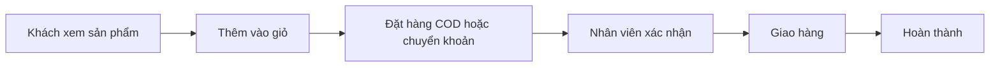

# Tổng quan nghiệp vụ — Website Bán hàng

> Mô tả demo này cho ai, giải quyết vấn đề gì. Cập nhật khi phạm vi thay đổi.

---

## 1. Thông tin chung

| Mục | Nội dung |
| :--- | :--- |
| Tên demo | Website Bán hàng |
| Mã dự án | `retail-website-ban-hang` |
| Ngành / loại khách hàng | Cửa hàng thời trang, mỹ phẩm, đồ gia dụng bán online |
| Loại sản phẩm | Website cho khách + web quản trị |
| Ý tưởng gốc | 2.1 · Website bán hàng (`ZDOCS/02-KE-HOACH/DANH-SACH-Y-TUONG.md`) |
| Người phụ trách | Mạnh Hùng (Pum) |
| Trạng thái | Đã code BE + FE, chạy được cả hai chế độ (dữ liệu mẫu và BE thật trên Postgres) |

## 2. Vấn đề của khách hàng

- Bán qua Facebook, Zalo phải trả lời từng tin nhắn
- Không có nơi trưng bày đầy đủ sản phẩm
- Đơn hàng ghi Excel dễ sót
- Không theo dõi được tồn kho theo màu, size

## 3. Giải pháp demo thể hiện

- Website có danh mục, bộ lọc, tìm kiếm, trang chi tiết sản phẩm với biến thể
- Giỏ hàng, đặt hàng COD hoặc chuyển khoản, tra cứu đơn
- Quản trị sản phẩm, đơn hàng, khách hàng, mã giảm giá
- Dashboard doanh thu

## 4. Vai trò người dùng

| Vai trò | Mã | Dùng trên | Làm được gì |
| :--- | :--- | :--- | :--- |
| Khách mua | — | Điện thoại | Xem, đặt hàng, tra cứu đơn |
| Quản trị viên | ADMIN | Desktop | Toàn quyền |
| Quản lý | MANAGER | Desktop | Sản phẩm, khuyến mãi, báo cáo |
| Nhân viên | STAFF | Desktop | Xử lý đơn hàng |

## 5. Phân hệ và chức năng

| Area | Chức năng | Màn hình (route FE dự kiến) | Ưu tiên |
| :--- | :--- | :--- | :---: |
| `System` | Đăng nhập, tài khoản, vai trò, cài đặt | Có sẵn | — |
| `Sales` | Trang chủ, danh mục, tìm kiếm | `/`, `/products` | P1 |
| `Sales` | Chi tiết sản phẩm, biến thể | `/products/[slug]` | P1 |
| `Sales` | Giỏ hàng, đặt hàng | `/cart`, `/checkout` | P1 |
| `Sales` | Đặt hàng thành công, QR chuyển khoản | `/checkout/success` | P1 |
| `Sales` | Tổng quan quản trị | `/dashboard` | P1 |
| `Sales` | Quản lý sản phẩm | `/admin/products` | P1 |
| `Sales` | Thêm, sửa sản phẩm và biến thể | `/admin/products/[id]` | P1 |
| `Sales` | Quản lý đơn hàng | `/admin/orders` | P1 |
| `Sales` | Chi tiết đơn, in phiếu giao hàng | `/admin/orders/[id]`, `/admin/orders/[id]/print` | P1 |
| `Sales` | Mã giảm giá | `/admin/coupons` | P2 |
| `Sales` | Tra cứu đơn | `/tra-cuu-don` | P2 |
| `Crm` | Khách hàng | `/admin/customers` | P2 |
| `Sales` | Báo cáo doanh thu | `/admin/reports` | P2 |

P1 = bắt buộc có để demo · P2 = nên có · P3 = làm thêm nếu còn thời gian.

## 6. Luồng nghiệp vụ chính

## 7. Phạm vi

**Có trong demo:**

- Website bán hàng và trang quản trị
- Đặt hàng, xử lý đơn, mã giảm giá

**Không làm (nói rõ với khách nếu được hỏi):**

- Thanh toán online thật
- Kết nối đơn vị vận chuyển thật
- Các kết nối bên ngoài khác chỉ giả lập

## 8. Dữ liệu mẫu cần chuẩn bị

| Dữ liệu | Số lượng | Ghi chú |
| :--- | :---: | :--- |
| Danh mục | 8 |  |
| Sản phẩm | 60 | Có ảnh, biến thể màu và size |
| Đơn hàng | ~800 | 90 ngày, đủ trạng thái |
| Khách hàng | 300 |  |
| Mã giảm giá | 5 |  |
