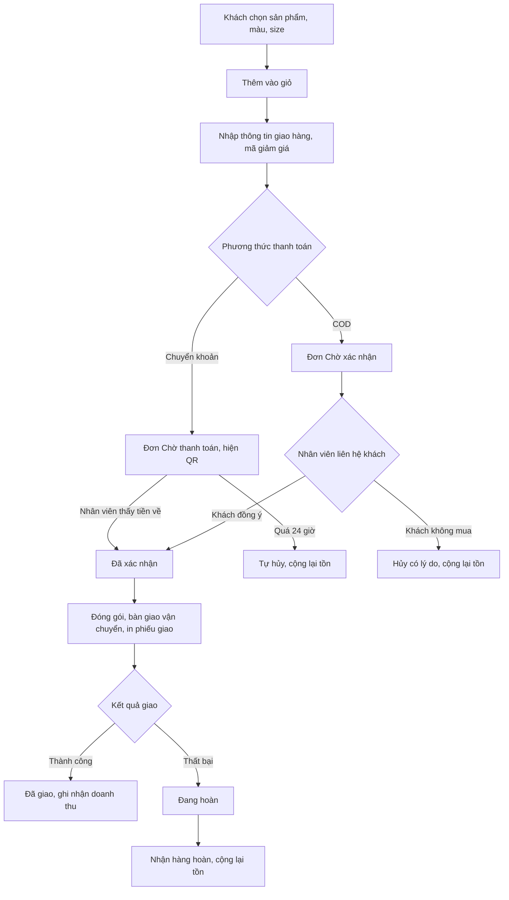
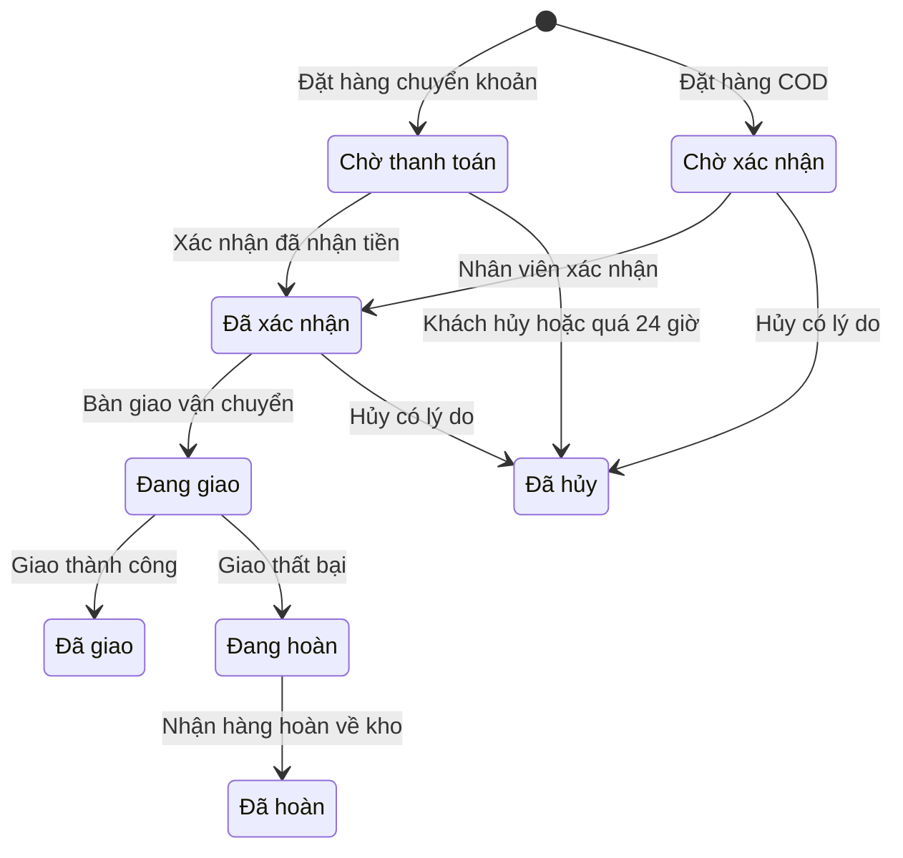

# Đặc tả yêu cầu phần mềm (SRS) — Website Bán hàng

| Phiên bản | Ngày | Trạng thái |
| :--- | :--- | :--- |
| 1.0 | 12/10/2026 | Bản nháp để triển khai demo |

> Cách viết, quy ước mã, mức độ chi tiết: `ZDOCS/05-HUONG-DAN/HUONG-DAN-VIET-TAI-LIEU-NGHIEP-VU.md`.
> Phần nền (đăng nhập, tài khoản, vai trò, cài đặt, đặt lại dữ liệu demo): `ZDOCS/03-KIEN-TRUC/USE-CASE-NEN.md`, không viết lại ở đây.

---

## 1. Giới thiệu

### 1.1. Mục đích

Tài liệu mô tả đầy đủ yêu cầu của bản demo Website Bán hàng: phần cửa hàng cho khách (xem, chọn biến thể, giỏ hàng, đặt hàng, tra cứu đơn) và phần quản trị (sản phẩm, tồn kho, xử lý đơn, mã giảm giá, khách hàng, báo cáo). Dev dùng để code, tester dùng để viết và chạy test case, sales dùng để biết demo làm được gì.

### 1.2. Phạm vi

**Trong phạm vi:** trang chủ, danh sách và tìm kiếm sản phẩm, chi tiết sản phẩm có biến thể màu × size, giỏ hàng, đặt hàng không cần tài khoản với COD hoặc chuyển khoản QR, mã giảm giá, tra cứu và tự hủy đơn; quản trị danh mục, sản phẩm, biến thể, tồn kho; xác nhận, hủy, bàn giao vận chuyển, in phiếu giao, cập nhật kết quả giao; hồ sơ khách theo số điện thoại; tổng quan và báo cáo.

**Ngoài phạm vi:** cổng thanh toán thật (VNPay, MoMo, thẻ), API đơn vị vận chuyển thật và phí vận chuyển theo cân nặng, tài khoản khách hàng và tích điểm, đổi size hoặc đổi trả sau khi giao, đồng bộ sàn thương mại điện tử, nhiều kho, hóa đơn điện tử, đánh giá sản phẩm của khách.

### 1.3. Thuật ngữ

| Thuật ngữ | Giải thích |
| :--- | :--- |
| Sản phẩm | Mặt hàng bán trên website, vd "Áo thun cotton basic" |
| Biến thể | Một tổ hợp màu × size của sản phẩm, có SKU và tồn kho riêng, vd Đen / L |
| SKU | Mã của biến thể: mã sản phẩm + mã màu + size, vd `AT001-DE-L` |
| Giá bán | Giá khách trả cho một sản phẩm, mọi biến thể dùng chung |
| Giá gốc | Giá niêm yết trước giảm, hiển thị gạch ngang; có thể để trống |
| Tồn kho | Số lượng biến thể còn bán được, đã trừ hàng của các đơn chưa hủy |
| Giỏ hàng | Danh sách biến thể khách chọn, lưu trên trình duyệt |
| Tạm tính | Tổng giá bán × số lượng của các dòng trong giỏ hoặc đơn |
| Đơn hàng | Yêu cầu mua hàng khách gửi qua website |
| COD | Giao hàng thu tiền: đơn vị vận chuyển thu tiền khách lúc giao |
| Tiền thu hộ | Số tiền đơn vị vận chuyển thu của khách khi giao, ghi trên phiếu giao |
| Mã giảm giá | Mã khách nhập khi đặt hàng để được giảm tiền hàng hoặc phí vận chuyển |
| Bàn giao vận chuyển | Giao gói hàng cho đơn vị vận chuyển và nhận mã vận đơn |
| Mã vận đơn | Mã đơn vị vận chuyển cấp để theo dõi gói hàng (demo sinh giả lập) |
| Hoàn hàng | Giao thất bại, gói hàng được trả về kho của shop |
| Doanh thu thuần | Tạm tính trừ giảm giá của đơn Đã giao, không gồm phí vận chuyển |
| Giá trị đặt hàng | Tổng thanh toán của các đơn đặt trong kỳ, không tính đơn Đã hủy |

### 1.4. Tài liệu liên quan

| Tài liệu | Nội dung |
| :--- | :--- |
| `01-TONG-QUAN-NGHIEP-VU.md` | Tổng quan nghiệp vụ |
| `03-USE-CASE.md` | Đặc tả use case |
| `05-KICH-BAN-KIEM-THU.md` | Test case nghiệm thu |
| `ZDOCS/03-KIEN-TRUC/USE-CASE-NEN.md` | Phần nền dùng chung |

---

## 2. Mô tả tổng quan

### 2.1. Bối cảnh sản phẩm

Shop thời trang bán online toàn quốc, một kho tại TP.HCM, 2–5 nhân viên xử lý đơn. Khách vào website từ Facebook, Zalo, Google, phần lớn bằng điện thoại, xem sản phẩm, chọn màu và size, đặt hàng COD hoặc chuyển khoản. Nhân viên trên máy tính xác nhận đơn, đóng gói, bàn giao cho đơn vị vận chuyển, theo dõi tới khi khách nhận hàng. Quản lý lên sản phẩm, chạy mã giảm giá, xem doanh thu và tỉ lệ hoàn. Dữ liệu mẫu dùng ngành thời trang vì có biến thể màu × size rõ nhất; mỹ phẩm, đồ gia dụng dùng cùng mô hình.

### 2.2. Tác nhân

| Mã vai trò | Tên | Thiết bị | Mục tiêu khi dùng hệ thống |
| :--- | :--- | :--- | :--- |
| — | Khách | Điện thoại | Tìm đúng mẫu, đúng màu và size còn hàng, đặt nhanh, biết đơn đang ở đâu |
| `ADMIN` | Quản trị viên | Desktop | Cấu hình hệ thống, tài khoản, phân quyền, thông tin shop |
| `MANAGER` | Quản lý | Desktop | Lên sản phẩm, chỉnh tồn, chạy mã giảm giá, xem doanh thu và báo cáo |
| `STAFF` | Nhân viên | Desktop | Xác nhận đơn, đóng gói, bàn giao vận chuyển, xử lý hủy và hoàn hàng |

Tài khoản demo: `admin`, `quanly`, `nhanvien`. Khách không đăng nhập.

### 2.3. Quy trình nghiệp vụ

### 2.4. Giả định và ràng buộc

- Một shop, một kho tại TP.HCM. Giá đã gồm VAT, là bội số của 1.000 ₫.
- Mọi biến thể của một sản phẩm cùng giá bán; biến thể chỉ khác nhau ở SKU và tồn kho.
- Khách đặt hàng không cần tài khoản; hệ thống nhận diện khách theo số điện thoại.
- Địa chỉ dùng danh mục hành chính 2 cấp (34 tỉnh/thành, phường/xã) theo sắp xếp đơn vị hành chính năm 2025.
- Phí vận chuyển đồng giá theo vùng, không tính theo cân nặng.
- QR chuyển khoản là ảnh giả lập theo định dạng VietQR; hệ thống không kiểm tra tiền đã về, nhân viên tự đối chiếu.
- Đơn vị vận chuyển, mã vận đơn, SMS và email gửi khách đều giả lập; tin gửi đi được ghi vào dòng thời gian của đơn.
- Phiếu giao hàng in bằng lệnh in của trình duyệt, khổ A6.

---

## 3. Yêu cầu chức năng

### 3.1. Tổng quan

| Mã | Yêu cầu | Ưu tiên | Vai trò | UC |
| :--- | :--- | :---: | :--- | :--- |
| FR-01 | Tổng quan hiển thị cho quản lý: doanh thu thuần hôm nay, giá trị đặt hàng hôm nay, số đơn mới hôm nay kèm mức tăng giảm so với hôm qua, tỉ lệ hủy và tỉ lệ hoàn 30 ngày gần nhất | P1 | MANAGER | UC-12 |
| FR-02 | Tổng quan hiển thị biểu đồ giá trị đặt hàng và doanh thu thuần 30 ngày, top 5 sản phẩm bán chạy 30 ngày, danh sách biến thể sắp hết (tồn 1–5) và hết hàng | P1 | MANAGER | UC-12 |
| FR-03 | Tổng quan hiển thị thẻ việc cần làm: số đơn Chờ xác nhận, Chờ thanh toán, Đã xác nhận chưa bàn giao, Đang hoàn, Giao chậm; bấm thẻ mở danh sách đơn đã lọc sẵn | P1 | STAFF, MANAGER | UC-12 |

### 3.2. Cửa hàng

| Mã | Yêu cầu | Ưu tiên | Vai trò | UC |
| :--- | :--- | :---: | :--- | :--- |
| FR-04 | Trang chủ hiển thị banner, lưới danh mục, sản phẩm nổi bật, 8 sản phẩm mới nhất và sản phẩm đang giảm giá | P1 | Khách | UC-01 |
| FR-05 | Trang danh sách sản phẩm cho lọc theo danh mục, khoảng giá, màu, size, "Chỉ hiện còn hàng"; sắp xếp theo mới nhất, bán chạy, giá tăng dần, giá giảm dần; 24 sản phẩm mỗi trang; bộ lọc lưu trên URL | P1 | Khách | UC-01 |
| FR-06 | Khách tìm sản phẩm theo tên hoặc SKU, gõ có dấu hay không dấu đều ra kết quả; từ 2 ký tự hiện gợi ý tối đa 5 sản phẩm kèm ảnh và giá | P1 | Khách | UC-01 |
| FR-07 | Trang chi tiết sản phẩm hiển thị bộ ảnh (tối đa 8, phóng to được), tên, giá bán, giá gốc gạch ngang và phần trăm giảm, chọn màu, chọn size, tình trạng hàng theo biến thể, bảng size, mô tả, 8 sản phẩm cùng danh mục | P1 | Khách | UC-02 |
| FR-08 | Khách chọn màu, size, số lượng rồi bấm "Thêm vào giỏ" hoặc "Mua ngay"; biến thể hết hàng bị gạch chéo, không chọn được | P1 | Khách | UC-02 |
| FR-09 | Giỏ hàng cho sửa số lượng, xóa dòng, xem tạm tính và số tiền còn thiếu để được miễn phí vận chuyển; giỏ lưu trên trình duyệt | P1 | Khách | UC-03 |
| FR-10 | Khách đặt hàng không cần tài khoản: nhập họ tên, số điện thoại, email (không bắt buộc), chọn tỉnh/thành, phường/xã, nhập địa chỉ chi tiết, ghi chú; phí vận chuyển tính ngay khi chọn tỉnh/thành | P1 | Khách | UC-04 |
| FR-11 | Khách chọn thanh toán COD hoặc chuyển khoản; trang thanh toán hiển thị tóm tắt gồm tạm tính, giảm giá, phí vận chuyển, tổng thanh toán | P1 | Khách | UC-04 |
| FR-12 | Khách nhập mã giảm giá ở trang thanh toán; hệ thống hiển thị số tiền giảm hoặc lý do mã không dùng được | P2 | Khách | UC-04 |
| FR-13 | Sau khi đặt, trang "Đặt hàng thành công" hiển thị mã đơn và tóm tắt đơn; đơn chuyển khoản có thêm mã QR giả lập kèm số tiền, nội dung chuyển khoản, hạn thanh toán; hệ thống gửi SMS và email xác nhận (giả lập) | P1 | Khách | UC-04 |
| FR-14 | Khách tra cứu đơn bằng mã đơn và số điện thoại: trạng thái, dòng thời gian, đơn vị vận chuyển, mã vận đơn, sản phẩm, tổng tiền | P2 | Khách | UC-05 |
| FR-15 | Khách tự hủy đơn đang Chờ thanh toán hoặc Chờ xác nhận ở trang tra cứu, chọn lý do | P2 | Khách | UC-05 |

### 3.3. Sản phẩm

| Mã | Yêu cầu | Ưu tiên | Vai trò | UC |
| :--- | :--- | :---: | :--- | :--- |
| FR-16 | Quản lý thêm, sửa, ẩn/hiện, sắp xếp thứ tự danh mục: tên, slug, ảnh đại diện | P1 | MANAGER | UC-06 |
| FR-17 | Quản lý thêm, sửa, ẩn/hiện sản phẩm: mã, tên, slug, danh mục, giá bán, giá gốc, bộ ảnh, mô tả, bảng size, đánh dấu nổi bật | P1 | MANAGER | UC-06 |
| FR-18 | Quản lý chọn danh sách màu và size của sản phẩm; hệ thống sinh lưới biến thể màu × size, mỗi biến thể có SKU, tồn kho và công tắc bật/tắt | P1 | MANAGER | UC-06 |
| FR-19 | Danh sách sản phẩm ở trang quản trị cho tìm theo tên, mã, SKU; lọc theo danh mục, trạng thái, tình trạng tồn (còn hàng, sắp hết, hết hàng); hiển thị tổng tồn và số biến thể hết hàng | P1 | MANAGER, STAFF | UC-06 |
| FR-20 | Quản lý điều chỉnh tồn kho của biến thể kèm lý do; hệ thống lưu lịch sử điều chỉnh | P2 | MANAGER | UC-06 |

### 3.4. Đơn hàng

| Mã | Yêu cầu | Ưu tiên | Vai trò | UC |
| :--- | :--- | :---: | :--- | :--- |
| FR-21 | Danh sách đơn có tab theo trạng thái kèm số đơn; tìm theo mã đơn, số điện thoại, tên khách; lọc theo ngày đặt, phương thức thanh toán, tỉnh/thành, nhãn (Trùng SĐT, Giao chậm, Khách cần lưu ý) | P1 | STAFF, MANAGER | UC-07 |
| FR-22 | Chi tiết đơn hiển thị khách, địa chỉ, các dòng sản phẩm (ảnh, màu, size, SKU, số lượng, đơn giá), tạm tính, giảm giá, phí vận chuyển, tổng thanh toán, phương thức và trạng thái thanh toán, ghi chú của khách, cảnh báo khách cần lưu ý | P1 | STAFF, MANAGER | UC-07 |
| FR-23 | Nhân viên thêm ghi chú nội bộ vào đơn; mọi lần đổi trạng thái và ghi chú hiện trên dòng thời gian kèm người làm, thời điểm | P1 | STAFF, MANAGER | UC-07 |
| FR-24 | Nhân viên xác nhận đơn Chờ xác nhận sau khi liên hệ khách | P1 | STAFF | UC-08 |
| FR-25 | Nhân viên xác nhận đã nhận tiền cho đơn Chờ thanh toán, nhập mã giao dịch ngân hàng | P1 | STAFF | UC-08 |
| FR-26 | Nhân viên sửa đơn Chờ xác nhận: đổi biến thể, số lượng, thêm hoặc xóa dòng, sửa người nhận và địa chỉ; hệ thống tính lại tiền | P2 | STAFF | UC-08 |
| FR-27 | Nhân viên hủy đơn chưa bàn giao vận chuyển, bắt buộc chọn lý do; hệ thống cộng lại tồn kho và trả lượt mã giảm giá | P1 | STAFF, MANAGER | UC-09 |
| FR-28 | Nhân viên bàn giao đơn Đã xác nhận cho đơn vị vận chuyển (giả lập): chọn đơn vị, nhập khối lượng; hệ thống sinh mã vận đơn và chuyển đơn sang Đang giao | P1 | STAFF | UC-10 |
| FR-29 | Nhân viên in phiếu giao hàng khổ A6 gồm mã đơn, mã vận đơn, người gửi, người nhận, số điện thoại, địa chỉ, danh sách sản phẩm, tiền thu hộ, ghi chú | P1 | STAFF | UC-10 |
| FR-30 | Nhân viên cập nhật kết quả giao: Đã giao, hoặc Giao thất bại kèm lý do; khi hàng hoàn về kho, nhân viên xác nhận "Đã nhận hàng hoàn" | P1 | STAFF | UC-11 |
| FR-31 | Nhân viên chọn nhiều đơn trên danh sách để xác nhận, bàn giao vận chuyển hoặc in phiếu giao cùng lúc | P3 | STAFF | UC-16 |

### 3.5. Mã giảm giá

| Mã | Yêu cầu | Ưu tiên | Vai trò | UC |
| :--- | :--- | :---: | :--- | :--- |
| FR-32 | Quản lý thêm, sửa, tạm dừng mã giảm giá: mã, kiểu (phần trăm, số tiền, miễn phí vận chuyển), giá trị, giảm tối đa, đơn tối thiểu, phạm vi (toàn shop hoặc một danh mục), tổng lượt, lượt mỗi khách, thời gian hiệu lực | P2 | MANAGER | UC-13 |
| FR-33 | Quản lý xem từng mã: số lượt đã dùng, tổng tiền đã giảm, danh sách đơn đã dùng mã | P2 | MANAGER | UC-13 |

### 3.6. Khách hàng

| Mã | Yêu cầu | Ưu tiên | Vai trò | UC |
| :--- | :--- | :---: | :--- | :--- |
| FR-34 | Hệ thống tự tạo hồ sơ khách theo số điện thoại khi có đơn mới; đơn sau cùng số điện thoại cập nhật tên, địa chỉ mới nhất | P2 | Hệ thống | UC-14 |
| FR-35 | Quản lý và nhân viên xem danh sách khách: tên, số điện thoại, tỉnh/thành, số đơn, số đơn đã giao, số đơn hoàn, tổng chi tiêu, ngày đặt gần nhất; tìm, lọc theo nhãn; mở lịch sử đơn của khách | P2 | MANAGER, STAFF | UC-14 |
| FR-36 | Hệ thống tự gắn nhãn "Khách VIP" và "Cần lưu ý" theo BR-21; quản lý thêm ghi chú cho khách | P2 | MANAGER | UC-14 |

### 3.7. Báo cáo

| Mã | Yêu cầu | Ưu tiên | Vai trò | UC |
| :--- | :--- | :---: | :--- | :--- |
| FR-37 | Báo cáo doanh thu theo ngày: giá trị đặt hàng, doanh thu thuần, số đơn, giá trị trung bình đơn, so với kỳ liền trước cùng độ dài | P2 | MANAGER | UC-15 |
| FR-38 | Báo cáo sản phẩm bán chạy theo sản phẩm và theo biến thể: số lượng, doanh thu thuần, tỉ trọng; lọc theo danh mục | P2 | MANAGER | UC-15 |
| FR-39 | Báo cáo tình trạng đơn: tỉ lệ hủy, tỉ lệ hoàn, lý do hủy, lý do giao thất bại; chia theo phương thức thanh toán và theo tỉnh/thành | P2 | MANAGER | UC-15 |
| FR-40 | Xuất báo cáo đang xem ra file Excel | P3 | MANAGER | UC-15 |

---

## 4. Quy tắc nghiệp vụ

| Mã | Quy tắc | Áp dụng cho |
| :--- | :--- | :--- |
| BR-01 | Giá bán và giá gốc là bội số của 1.000 ₫. Giá gốc để trống hoặc lớn hơn giá bán. Phần trăm giảm hiển thị = (giá gốc − giá bán) / giá gốc × 100, làm tròn tới số nguyên gần nhất, vd 159.000 ₫ / 199.000 ₫ hiển thị "−20%" | FR-07, FR-17 |
| BR-02 | Tình trạng biến thể: tồn 0 là "Hết hàng", không chọn được; tồn 1–5 hiện "Chỉ còn N sản phẩm"; tồn trên 5 là "Còn hàng". Sản phẩm hết hàng ở mọi biến thể có nhãn "Hết hàng" và xếp cuối khi sắp xếp mặc định | FR-05, FR-07, FR-08 |
| BR-03 | Số lượng mỗi dòng giỏ từ 1 tới min(10, tồn kho biến thể). Giỏ tối đa 20 dòng. Thêm lại cùng biến thể thì cộng số lượng vào dòng cũ | FR-08, FR-09 |
| BR-04 | Giỏ lưu trên trình duyệt 30 ngày. Mỗi lần mở giỏ hoặc trang thanh toán, hệ thống lấy lại giá và tồn mới nhất: dòng đổi giá hiện thông báo giá cũ và giá mới; dòng hết hàng hoặc sản phẩm đã ẩn bị đánh dấu, phải xóa mới đặt hàng được | FR-09 |
| BR-05 | Tạm tính = Σ (giá bán × số lượng). Tổng thanh toán = tạm tính − giảm giá + phí vận chuyển. Giảm giá không vượt tạm tính | FR-09, FR-11 |
| BR-06 | Phí vận chuyển: địa chỉ ở TP.HCM 20.000 ₫, tỉnh/thành khác 35.000 ₫. Miễn phí khi tạm tính − giảm giá ≥ 499.000 ₫. Giỏ hiện "Mua thêm X ₫ để được miễn phí vận chuyển" với X = 499.000 − (tạm tính − giảm giá) | FR-09, FR-10 |
| BR-07 | Thông tin giao hàng: họ tên 2–100 ký tự; số điện thoại di động 10 số theo mẫu `^0(3\|5\|7\|8\|9)\d{8}$`; email đúng định dạng nếu có nhập; tỉnh/thành và phường/xã chọn từ danh mục; địa chỉ chi tiết 5–200 ký tự; ghi chú tối đa 500 ký tự | FR-10 |
| BR-08 | Cách tính mã giảm giá. Phần trăm: tiền giảm = phần tạm tính thuộc phạm vi × phần trăm, làm tròn xuống tới bội số 1.000 ₫, không vượt mức giảm tối đa. Số tiền: giảm đúng số tiền, không vượt phần tạm tính thuộc phạm vi. Miễn phí vận chuyển: phí vận chuyển về 0 ₫; nếu đơn đã được miễn phí theo BR-06 thì báo "Đơn đã được miễn phí vận chuyển" và không áp mã | FR-12 |
| BR-09 | Mã hợp lệ khi đang hoạt động, trong thời gian hiệu lực, còn tổng lượt, phần tạm tính thuộc phạm vi đạt đơn tối thiểu. Lượt mỗi khách (mặc định 1) kiểm tra theo số điện thoại lúc bấm "Đặt hàng". Mỗi đơn dùng tối đa một mã; khách nhập không phân biệt hoa thường. Lượt dùng tăng khi tạo đơn, trả lại khi đơn Đã hủy, không trả khi đơn hoàn hàng | FR-12, FR-27, FR-32 |
| BR-10 | Mã đơn: `DH` + `yyMMdd` + số thứ tự 4 chữ số trong ngày, vd `DH2610120027` | FR-13 |
| BR-11 | Đơn COD tạo ra ở trạng thái Chờ xác nhận. Đơn chuyển khoản tạo ra ở trạng thái Chờ thanh toán, hạn thanh toán 24 giờ kể từ lúc đặt; quá hạn hệ thống tự hủy với lý do "Quá hạn thanh toán" | FR-13, FR-25, FR-27 |
| BR-12 | QR chuyển khoản có số tiền bằng tổng thanh toán, nội dung là mã đơn. Xác nhận đã nhận tiền bắt buộc nhập mã giao dịch ngân hàng 6–30 ký tự chữ và số | FR-13, FR-25 |
| BR-13 | Tồn kho giảm ngay khi tạo đơn; cộng lại khi đơn Đã hủy; cộng lại khi đơn chuyển sang Đã hoàn. Sửa đơn thì trừ hoặc cộng phần chênh lệch. Kiểm tra và trừ tồn trong cùng một giao dịch, tồn không bao giờ âm | FR-08, FR-26, FR-27, FR-30 |
| BR-14 | Chỉ chuyển trạng thái đơn theo sơ đồ §5.2. Mỗi lần chuyển ghi một sự kiện vào dòng thời gian: thời điểm, người làm (hoặc "Hệ thống", "Khách"), trạng thái trước và sau, ghi chú | FR-23, FR-24, FR-25, FR-27, FR-28, FR-30 |
| BR-15 | Chỉ sửa được đơn COD đang Chờ xác nhận. Sửa đơn tính lại tạm tính, phí vận chuyển, mã giảm giá theo BR-05, BR-06, BR-08; mã không còn hợp lệ thì tự gỡ và báo cho nhân viên | FR-26 |
| BR-16 | Hủy đơn bắt buộc chọn lý do: Khách đổi ý, Không liên lạc được, Hết hàng, Đặt trùng, Quá hạn thanh toán, Khác (kèm ghi chú). Khách tự hủy chỉ khi đơn Chờ thanh toán hoặc Chờ xác nhận. Đơn chuyển khoản đã thanh toán mà bị hủy thì trạng thái thanh toán chuyển "Cần hoàn tiền" với số tiền bằng tổng thanh toán; quản lý hoàn tiền ngoài hệ thống rồi đánh dấu "Đã hoàn tiền" | FR-15, FR-27 |
| BR-17 | Bàn giao vận chuyển: đơn vị chọn trong GHN, GHTK, Viettel Post, J&T Express (giả lập); khối lượng 50–30.000 g. Mã vận đơn giả lập = mã đơn vị (`GHN`, `GHTK`, `VTP`, `JT`) + 10 chữ số. Tiền thu hộ = tổng thanh toán với đơn COD, 0 ₫ với đơn đã chuyển khoản | FR-28, FR-29 |
| BR-18 | Đơn Đang giao quá 5 ngày kể từ lúc bàn giao mà chưa có kết quả thì gắn nhãn "Giao chậm" | FR-03, FR-21 |
| BR-19 | Giao thành công: đơn COD chuyển trạng thái thanh toán sang "Đã thanh toán". Giao thất bại bắt buộc chọn lý do: Khách không nghe máy, Khách từ chối nhận, Sai địa chỉ, Khác; đơn chuyển Đang hoàn. Nhân viên xác nhận "Đã nhận hàng hoàn" thì đơn chuyển Đã hoàn | FR-30 |
| BR-20 | Đơn mới có cùng số điện thoại với một đơn khác đang Chờ thanh toán hoặc Chờ xác nhận, đặt trong 24 giờ trước đó, thì cả hai đơn gắn nhãn "Trùng SĐT" | FR-21, FR-22 |
| BR-21 | Tổng chi tiêu của khách = Σ tổng thanh toán các đơn Đã giao. Nhãn "Khách VIP" khi tổng chi tiêu ≥ 5.000.000 ₫. Nhãn "Cần lưu ý" khi khách có từ 2 đơn Đang hoàn hoặc Đã hoàn; đơn mới của khách này hiện cảnh báo ở chi tiết đơn | FR-22, FR-34, FR-36 |
| BR-22 | Doanh thu thuần = Σ (tạm tính − giảm giá) của đơn Đã giao, tính theo ngày giao thành công, không gồm phí vận chuyển. Giá trị đặt hàng = Σ tổng thanh toán của đơn đặt trong ngày, không tính đơn Đã hủy. Tỉ lệ hủy = số đơn Đã hủy / số đơn đặt trong kỳ. Tỉ lệ hoàn = (Đang hoàn + Đã hoàn) / (Đã giao + Đang hoàn + Đã hoàn). Tỉ lệ làm tròn 1 chữ số thập phân | FR-01, FR-02, FR-37, FR-39 |
| BR-23 | Sản phẩm đã có trong đơn không xóa được, chỉ ẩn; biến thể đã có trong đơn không xóa được, chỉ tắt. Sản phẩm ẩn không hiện ở cửa hàng; mở link cũ hiện "Sản phẩm ngừng kinh doanh" | FR-17, FR-18 |
| BR-24 | Slug sinh từ tên: bỏ dấu, chữ thường, khoảng trắng thành `-`; trùng thì thêm `-2`, `-3`. Mã sản phẩm 2 chữ in hoa + 3 số, không trùng. SKU = mã sản phẩm + `-` + mã màu + `-` + size, không trùng; sản phẩm không có size thì bỏ phần size | FR-17, FR-18 |
| BR-25 | Dòng đơn lưu tên sản phẩm, màu, size, SKU, ảnh và đơn giá tại thời điểm đặt. Đổi giá hoặc tên sản phẩm sau đó không làm thay đổi đơn cũ | FR-13, FR-22 |
| BR-26 | Mã giảm giá 4–20 ký tự chữ in hoa và số, không trùng. Kiểu phần trăm có giá trị 1–50% và bắt buộc có mức giảm tối đa. Thời điểm kết thúc sau thời điểm bắt đầu. Mã đã có lượt dùng không xóa được, chỉ tạm dừng | FR-32 |
| BR-27 | Điều chỉnh tồn: tồn mới là số nguyên ≥ 0; lý do bắt buộc (Nhập hàng, Kiểm kê, Hàng lỗi, Khác); lưu tồn trước, tồn sau, người điều chỉnh, thời điểm | FR-20 |
| BR-28 | Trang tra cứu đơn che bớt thông tin: số điện thoại chỉ hiện 3 số đầu và 3 số cuối (vd `098****321`), địa chỉ chỉ hiện phường/xã và tỉnh/thành; không hiện ghi chú nội bộ. Tra cứu sai 5 lần trong 10 phút từ một trình duyệt thì tạm chặn 10 phút | FR-14 |

---

## 5. Yêu cầu dữ liệu

### 5.1. Thực thể

| Thực thể | Mô tả | Thuộc tính chính | Quan hệ |
| :--- | :--- | :--- | :--- |
| Danh mục | Nhóm sản phẩm trên menu cửa hàng | Tên, slug, ảnh, thứ tự, hiển thị | Có nhiều sản phẩm |
| Sản phẩm | Mặt hàng bán | Mã, tên, slug, giá bán, giá gốc, mô tả, bảng size, nổi bật, trạng thái (đang bán, ẩn), số đã bán | Thuộc một danh mục; có nhiều ảnh, nhiều biến thể |
| Ảnh sản phẩm | Ảnh trong bộ ảnh | Đường dẫn, thứ tự, ảnh đại diện, màu gắn kèm (không bắt buộc) | Thuộc một sản phẩm |
| Màu | Danh mục màu dùng chung | Tên, mã viết tắt (`TR`, `DE`, `BE`), mã màu hiển thị | Dùng cho nhiều biến thể |
| Biến thể | Tổ hợp màu × size | SKU, màu, size, tồn kho, bật/tắt | Thuộc một sản phẩm; có nhiều lần điều chỉnh tồn |
| Điều chỉnh tồn | Lịch sử thay đổi tồn thủ công | Tồn trước, tồn sau, lý do, ghi chú, người điều chỉnh, thời điểm | Thuộc một biến thể |
| Đơn hàng | Đơn khách đặt | Mã, thời điểm đặt, người nhận, số điện thoại, email, tỉnh/thành, phường/xã, địa chỉ chi tiết, ghi chú khách, tạm tính, giảm giá, phí vận chuyển, tổng thanh toán, phương thức thanh toán, trạng thái, trạng thái thanh toán, mã giao dịch, hạn thanh toán, lý do hủy, nhãn | Thuộc một khách; có nhiều dòng, nhiều sự kiện; gắn tối đa một mã giảm giá; có tối đa một vận đơn |
| Dòng đơn | Một biến thể trong đơn | Tên sản phẩm, màu, size, SKU, ảnh, đơn giá, số lượng, thành tiền | Thuộc một đơn; tham chiếu một biến thể |
| Sự kiện đơn | Một dòng trên dòng thời gian | Loại (đổi trạng thái, ghi chú nội bộ, tin gửi khách), trạng thái trước, trạng thái sau, nội dung, người làm, thời điểm | Thuộc một đơn |
| Vận đơn | Thông tin giao hàng | Đơn vị vận chuyển, mã vận đơn, khối lượng, tiền thu hộ, thời điểm bàn giao, thời điểm giao xong, lý do giao thất bại | Thuộc một đơn |
| Mã giảm giá | Mã khách nhập khi đặt | Mã, tên, kiểu, giá trị, giảm tối đa, đơn tối thiểu, phạm vi, tổng lượt, lượt mỗi khách, số lượt đã dùng, bắt đầu, kết thúc, trạng thái | Dùng trong nhiều đơn; có thể gắn một danh mục |
| Khách hàng | Người mua, nhận diện bằng số điện thoại | Số điện thoại, tên, email, địa chỉ gần nhất, số đơn, tổng chi tiêu, nhãn, ghi chú | Có nhiều đơn |
| Tỉnh/thành, Phường/xã | Danh mục hành chính 2 cấp | Mã, tên, vùng phí vận chuyển (TP.HCM, tỉnh khác) | Tỉnh/thành có nhiều phường/xã |

### 5.2. Vòng đời

**Đơn hàng**

**Thanh toán của đơn:** Chưa thanh toán → Đã thanh toán (đơn chuyển khoản khi nhân viên xác nhận tiền về, đơn COD khi Đã giao). Đơn chuyển khoản Đã thanh toán bị hủy → Cần hoàn tiền → Đã hoàn tiền.

**Mã giảm giá:** Sắp chạy (chưa tới ngày bắt đầu) → Đang chạy → Hết lượt (đủ tổng lượt) hoặc Hết hạn (qua ngày kết thúc); quản lý chuyển qua lại giữa Đang chạy và Tạm dừng.

**Sản phẩm:** Đang bán ↔ Ẩn. Biến thể: Bật ↔ Tắt; tình trạng hàng tính theo tồn (BR-02).

### 5.3. Mã chứng từ

| Chứng từ | Định dạng | Ví dụ |
| :--- | :--- | :--- |
| Đơn hàng | `DH` + `yyMMdd` + 4 số | `DH2610120027` |
| Sản phẩm | 2 chữ in hoa + 3 số | `AT001` |
| SKU | Mã sản phẩm + mã màu + size | `AT001-DE-L` |
| Mã giảm giá | 4–20 ký tự chữ in hoa và số | `GIAM10` |
| Mã vận đơn (giả lập) | Mã đơn vị + 10 số | `GHTK2610123456` |

---

## 6. Báo cáo

| Báo cáo | Chỉ số | Bộ lọc | Vai trò |
| :--- | :--- | :--- | :--- |
| Tổng quan quản lý | Doanh thu thuần, giá trị đặt hàng, số đơn mới so hôm qua, tỉ lệ hủy, tỉ lệ hoàn 30 ngày, biểu đồ 30 ngày, top 5 sản phẩm, biến thể sắp hết | — | MANAGER |
| Tổng quan việc cần làm | Số đơn Chờ xác nhận, Chờ thanh toán, chờ bàn giao, Đang hoàn, Giao chậm | — | STAFF, MANAGER |
| Doanh thu theo ngày | Giá trị đặt hàng, doanh thu thuần, số đơn, giá trị trung bình đơn, so kỳ trước | Khoảng ngày | MANAGER |
| Sản phẩm bán chạy | Số lượng, doanh thu thuần, tỉ trọng theo sản phẩm và biến thể | Khoảng ngày, danh mục | MANAGER |
| Tình trạng đơn | Tỉ lệ hủy, tỉ lệ hoàn, lý do hủy, lý do giao thất bại | Khoảng ngày, phương thức thanh toán | MANAGER |
| Theo tỉnh/thành | Số đơn, doanh thu thuần, tỉ lệ hoàn mỗi tỉnh/thành | Khoảng ngày | MANAGER |
| Hiệu quả mã giảm giá | Số lượt dùng, tổng tiền giảm, giá trị đặt hàng của đơn có mã | Khoảng ngày, mã | MANAGER |

---

## 7. Phân quyền

> Quyền nền (`dashboard`, `users`, `roles`, `settings`, `audit-logs`) xem `USE-CASE-NEN.md` §7.

| Mã quyền | Mô tả | ADMIN | MANAGER | STAFF |
| :--- | :--- | :---: | :---: | :---: |
| `products.view` | Xem sản phẩm, biến thể, tồn kho | ✓ | ✓ | ✓ |
| `products.create` / `update` / `delete` | Quản lý danh mục, sản phẩm, biến thể | ✓ | ✓ | |
| `products.adjust-stock` | Điều chỉnh tồn kho | ✓ | ✓ | |
| `orders.view` | Xem danh sách, chi tiết đơn | ✓ | ✓ | ✓ |
| `orders.confirm` | Xác nhận đơn | ✓ | ✓ | ✓ |
| `orders.confirm-payment` | Xác nhận đã nhận tiền chuyển khoản | ✓ | ✓ | ✓ |
| `orders.update` | Sửa đơn Chờ xác nhận, ghi chú nội bộ | ✓ | ✓ | ✓ |
| `orders.cancel` | Hủy đơn chưa bàn giao | ✓ | ✓ | ✓ |
| `orders.ship` | Bàn giao vận chuyển, in phiếu giao, cập nhật kết quả giao | ✓ | ✓ | ✓ |
| `orders.refund` | Đánh dấu đã hoàn tiền cho đơn chuyển khoản bị hủy | ✓ | ✓ | |
| `coupons.view` | Xem mã giảm giá | ✓ | ✓ | ✓ |
| `coupons.create` / `update` / `delete` | Quản lý mã giảm giá | ✓ | ✓ | |
| `customers.view` | Xem khách, lịch sử đơn | ✓ | ✓ | ✓ |
| `customers.update` | Sửa ghi chú khách | ✓ | ✓ | |
| `reports.view` | Xem báo cáo và các thẻ doanh thu ở Tổng quan | ✓ | ✓ | |

Trang cửa hàng (`/`, `/products`, `/cart`, `/checkout`, `/tra-cuu-don`) công khai, không cần quyền.

---

## 8. Yêu cầu phi chức năng

> Yêu cầu chung (bảo mật JWT, phân quyền, tiếng Việt, chế độ dữ liệu mẫu) theo `ZDOCS/03-KIEN-TRUC/KIEN-TRUC-HE-THONG.md`. Ở đây chỉ ghi yêu cầu riêng của dự án.

| Mã | Yêu cầu |
| :--- | :--- |
| NFR-01 | Trang cửa hàng thiết kế ưu tiên điện thoại rộng 375–430 px; vùng chạm tối thiểu 44×44 px; nút "Thêm vào giỏ" và "Đặt hàng" nằm ở thanh cố định cuối màn hình |
| NFR-02 | Trang chủ, danh sách và chi tiết sản phẩm hiển thị nội dung chính dưới 2,5 giây trên mạng 4G; ảnh nén WebP, ảnh ngoài màn hình tải lười |
| NFR-03 | Từ giỏ hàng tới đặt xong tối đa 3 màn hình (giỏ, thanh toán, thành công), không bắt tạo tài khoản; ô số điện thoại mở bàn phím số |
| NFR-04 | Trang sản phẩm có URL theo slug, thẻ title, meta description, ảnh Open Graph; trang danh sách và chi tiết render phía máy chủ để Google đọc được |
| NFR-05 | Bấm "Đặt hàng" nhiều lần hoặc mất mạng giữa chừng chỉ tạo một đơn (mã yêu cầu duy nhất); hai khách cùng mua biến thể cuối cùng thì chỉ một đơn thành công, tồn không âm |
| NFR-06 | Trang quản trị tối ưu desktop 1366×768; danh sách đơn 50 dòng mỗi trang, lọc và tìm phản hồi dưới 1 giây với 800 đơn |
| NFR-07 | Phiếu giao hàng in vừa khổ A6 (105×148 mm), mã đơn và mã vận đơn in kèm mã vạch, chữ tối thiểu 10 pt |
| NFR-08 | Dữ liệu mẫu đủ 90 ngày, khoảng 800 đơn có đủ 8 trạng thái; tỉ lệ hủy 5–8%, tỉ lệ hoàn 8–12%; đơn tập trung buổi tối 20–22h |

---

## 9. Danh sách màn hình

| Mã | Màn hình | Route | Vai trò | Thiết bị | UC |
| :--- | :--- | :--- | :--- | :--- | :--- |
| SCR-01 | Trang chủ | `/` | Khách | Điện thoại | UC-01 |
| SCR-02 | Danh sách sản phẩm, tìm kiếm | `/products` | Khách | Điện thoại | UC-01 |
| SCR-03 | Chi tiết sản phẩm | `/products/[slug]` | Khách | Điện thoại | UC-02 |
| SCR-04 | Giỏ hàng | `/cart` | Khách | Điện thoại | UC-03 |
| SCR-05 | Thanh toán (thông tin giao hàng, mã giảm giá) | `/checkout` | Khách | Điện thoại | UC-04 |
| SCR-06 | Đặt hàng thành công, QR chuyển khoản | `/checkout/success` | Khách | Điện thoại | UC-04 |
| SCR-07 | Tra cứu đơn | `/tra-cuu-don` | Khách | Điện thoại | UC-05 |
| SCR-08 | Tổng quan | `/dashboard` | MANAGER, STAFF | Desktop | UC-12 |
| SCR-09 | Sản phẩm (tab Sản phẩm, Danh mục) | `/admin/products` | MANAGER, STAFF | Desktop | UC-06 |
| SCR-10 | Thêm, sửa sản phẩm và biến thể | `/admin/products/[id]` | MANAGER | Desktop | UC-06 |
| SCR-11 | Danh sách đơn | `/admin/orders` | STAFF, MANAGER | Desktop | UC-07, UC-16 |
| SCR-12 | Chi tiết đơn | `/admin/orders/[id]` | STAFF, MANAGER | Desktop | UC-07, UC-08, UC-09, UC-10, UC-11 |
| SCR-13 | Phiếu giao hàng (bản in) | `/admin/orders/[id]/print` | STAFF | Máy in A6 | UC-10 |
| SCR-14 | Mã giảm giá | `/admin/coupons` | MANAGER | Desktop | UC-13 |
| SCR-15 | Khách hàng | `/admin/customers` | MANAGER, STAFF | Desktop | UC-14 |
| SCR-16 | Báo cáo | `/admin/reports` | MANAGER | Desktop | UC-15 |
