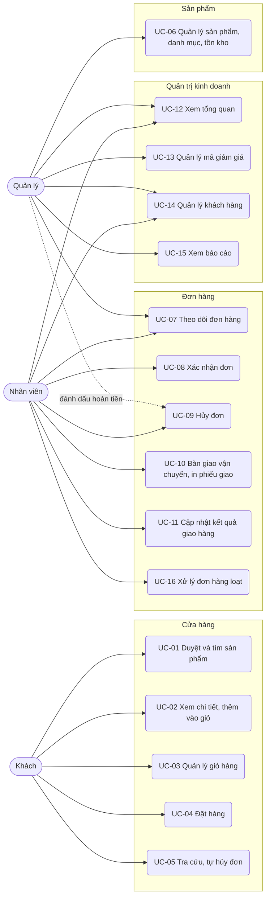
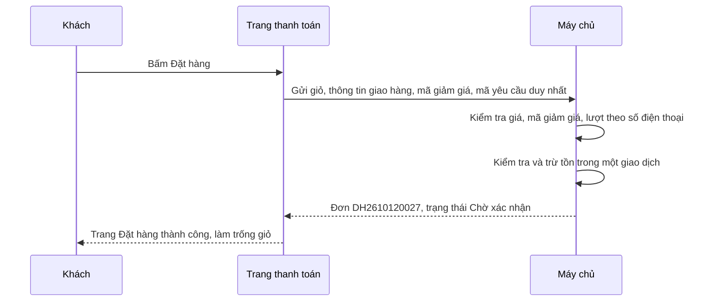

# Đặc tả use case — Website Bán hàng

> Use case phần nền (UC-SYS-01 đến UC-SYS-10): `ZDOCS/03-KIEN-TRUC/USE-CASE-NEN.md`.
> Mã FR, BR, SCR tham chiếu `02-SRS.md`.

---

## 1. Tác nhân

| Tác nhân | Mã vai trò | Use case chính |
| :--- | :--- | :--- |
| Khách | — | UC-01, UC-02, UC-03, UC-04, UC-05 |
| Nhân viên | `STAFF` | UC-07, UC-08, UC-09, UC-10, UC-11, UC-12, UC-14, UC-16 |
| Quản lý | `MANAGER` | UC-06, UC-07, UC-09 (hoàn tiền), UC-12, UC-13, UC-14, UC-15 |
| Quản trị viên | `ADMIN` | Toàn bộ, cộng phần nền |

---

## 2. Sơ đồ use case

---

## 3. Danh sách use case

| Mã | Tên | Tác nhân chính | Module | Ưu tiên | FR |
| :--- | :--- | :--- | :--- | :---: | :--- |
| UC-01 | Duyệt và tìm sản phẩm | Khách | Cửa hàng | P1 | FR-04, FR-05, FR-06 |
| UC-02 | Xem chi tiết, thêm vào giỏ | Khách | Cửa hàng | P1 | FR-07, FR-08 |
| UC-03 | Quản lý giỏ hàng | Khách | Cửa hàng | P1 | FR-09 |
| UC-04 | Đặt hàng | Khách | Cửa hàng | P1 | FR-10, FR-11, FR-12, FR-13, FR-34 |
| UC-05 | Tra cứu, tự hủy đơn | Khách | Cửa hàng | P2 | FR-14, FR-15 |
| UC-06 | Quản lý sản phẩm, danh mục, tồn kho | Quản lý | Sản phẩm | P1 | FR-16, FR-17, FR-18, FR-19, FR-20 |
| UC-07 | Theo dõi đơn hàng | Nhân viên, Quản lý | Đơn hàng | P1 | FR-21, FR-22, FR-23 |
| UC-08 | Xác nhận đơn | Nhân viên | Đơn hàng | P1 | FR-24, FR-25, FR-26 |
| UC-09 | Hủy đơn | Nhân viên | Đơn hàng | P1 | FR-27 |
| UC-10 | Bàn giao vận chuyển, in phiếu giao | Nhân viên | Đơn hàng | P1 | FR-28, FR-29 |
| UC-11 | Cập nhật kết quả giao hàng | Nhân viên | Đơn hàng | P1 | FR-30 |
| UC-12 | Xem tổng quan | Quản lý, Nhân viên | Quản trị kinh doanh | P1 | FR-01, FR-02, FR-03 |
| UC-13 | Quản lý mã giảm giá | Quản lý | Quản trị kinh doanh | P2 | FR-32, FR-33 |
| UC-14 | Quản lý khách hàng | Quản lý, Nhân viên | Quản trị kinh doanh | P2 | FR-34, FR-35, FR-36 |
| UC-15 | Xem báo cáo | Quản lý | Quản trị kinh doanh | P2 | FR-37, FR-38, FR-39, FR-40 |
| UC-16 | Xử lý đơn hàng loạt | Nhân viên | Đơn hàng | P3 | FR-31 |

---

## 4. Đặc tả chi tiết

### UC-01: Duyệt và tìm sản phẩm

| Mục | Nội dung |
| :--- | :--- |
| Tác nhân chính | Khách |
| Mô tả | Tìm sản phẩm theo danh mục, bộ lọc màu, size, giá, hoặc từ khóa |
| Ưu tiên | P1 |
| Điều kiện kích hoạt | Khách vào website từ quảng cáo, tin nhắn hoặc Google |
| Tiền điều kiện | Không |
| Hậu điều kiện | Khách mở được trang chi tiết sản phẩm cần mua |
| Yêu cầu liên quan | FR-04, FR-05, FR-06, BR-02 |
| Màn hình | SCR-01, SCR-02 |

**Luồng chính**

1. Khách mở trang chủ; hệ thống hiển thị banner, lưới danh mục, sản phẩm nổi bật, 8 sản phẩm mới, sản phẩm đang giảm giá.
2. Khách chọn một danh mục; hệ thống mở danh sách sản phẩm của danh mục, sắp xếp mặc định "Mới nhất".
3. Khách mở bộ lọc, chọn khoảng giá, màu, size, bật "Chỉ hiện còn hàng", bấm "Áp dụng".
4. Hệ thống hiển thị các sản phẩm có ít nhất một biến thể khớp màu, size và còn hàng, kèm số kết quả; bộ lọc ghi lên URL để khách gửi link cho người khác.
5. Khách chạm vào thẻ sản phẩm để xem chi tiết (UC-02).

**Luồng thay thế**

- 2a. Tìm kiếm: khách gõ từ khóa vào ô tìm; từ 2 ký tự hệ thống gợi ý tối đa 5 sản phẩm kèm ảnh, giá; bấm Enter mở danh sách kết quả. Gõ "ao thun" hay "áo thun" đều ra cùng kết quả.
- 3a. Đổi sắp xếp: Bán chạy, Giá tăng dần, Giá giảm dần.
- 4a. Kéo tới cuối trang: chuyển trang kế tiếp, 24 sản phẩm mỗi trang.

**Luồng ngoại lệ**

- E1. Không có kết quả: hiển thị "Không tìm thấy sản phẩm phù hợp", nút "Xóa bộ lọc" và gợi ý sản phẩm nổi bật.
- E2. Link danh mục đã ẩn: chuyển về danh sách tất cả sản phẩm.

### UC-02: Xem chi tiết, thêm vào giỏ

| Mục | Nội dung |
| :--- | :--- |
| Tác nhân chính | Khách |
| Mô tả | Xem ảnh, giá, chọn màu, size còn hàng và thêm vào giỏ |
| Ưu tiên | P1 |
| Điều kiện kích hoạt | Khách chạm vào một sản phẩm |
| Tiền điều kiện | Sản phẩm đang bán |
| Hậu điều kiện | Biến thể được thêm vào giỏ với số lượng hợp lệ |
| Yêu cầu liên quan | FR-07, FR-08, BR-01, BR-02, BR-03, BR-23 |
| Màn hình | SCR-03 |

**Luồng chính**

1. Hệ thống hiển thị bộ ảnh, tên, giá bán, giá gốc gạch ngang và phần trăm giảm (BR-01), các nút màu, các nút size, mô tả, bảng size, sản phẩm cùng danh mục.
2. Khách chọn màu; ảnh chuyển sang ảnh của màu đó nếu có; các size hết hàng của màu này bị gạch chéo.
3. Khách chọn size; hệ thống hiển thị tình trạng hàng theo BR-02.
4. Khách chỉnh số lượng, mặc định 1.
5. Khách bấm "Thêm vào giỏ"; hệ thống thêm dòng vào giỏ (BR-03), hiện thông báo kèm nút "Xem giỏ hàng", số trên biểu tượng giỏ tăng.

**Luồng thay thế**

- 1a. Sản phẩm chỉ có một biến thể: hệ thống chọn sẵn màu và size.
- 5a. "Mua ngay": thêm vào giỏ và chuyển thẳng tới trang thanh toán.
- 5b. Biến thể đã có trong giỏ: cộng số lượng vào dòng cũ, không vượt giới hạn BR-03.

**Luồng ngoại lệ**

- E1. Chưa chọn màu hoặc size: nút "Thêm vào giỏ" bị khóa, hiện "Vui lòng chọn size".
- E2. Số lượng vượt tồn: nút tăng dừng ở mức tồn, hiện "Chỉ còn N sản phẩm".
- E3. Sản phẩm đã ẩn: trang hiện "Sản phẩm ngừng kinh doanh" và gợi ý sản phẩm cùng danh mục (BR-23).

### UC-03: Quản lý giỏ hàng

| Mục | Nội dung |
| :--- | :--- |
| Tác nhân chính | Khách |
| Mô tả | Xem và chỉnh giỏ trước khi đặt, biết còn thiếu bao nhiêu để được miễn phí vận chuyển |
| Ưu tiên | P1 |
| Điều kiện kích hoạt | Khách bấm biểu tượng giỏ hoặc "Xem giỏ hàng" |
| Tiền điều kiện | Không |
| Hậu điều kiện | Giỏ chỉ còn dòng hợp lệ, sẵn sàng đặt hàng |
| Yêu cầu liên quan | FR-09, BR-03, BR-04, BR-05, BR-06 |
| Màn hình | SCR-04 |

**Luồng chính**

1. Khách mở giỏ; hệ thống lấy lại giá và tồn mới nhất (BR-04).
2. Hệ thống hiển thị các dòng: ảnh, tên, màu, size, đơn giá, số lượng, thành tiền; tạm tính theo BR-05.
3. Hệ thống hiển thị dải tiến độ "Mua thêm X ₫ để được miễn phí vận chuyển" hoặc "Đơn được miễn phí vận chuyển" (BR-06).
4. Khách sửa số lượng hoặc xóa dòng; tạm tính và dải tiến độ cập nhật ngay.
5. Khách bấm "Đặt hàng" để sang trang thanh toán (UC-04).

**Luồng thay thế**

- 1a. Giỏ trống: hiển thị "Giỏ hàng trống" và nút "Tiếp tục mua sắm".
- 4a. Đổi màu hoặc size của một dòng: chọn lại trên dòng; nếu trùng biến thể với dòng khác thì hai dòng gộp làm một.

**Luồng ngoại lệ**

- E1. Dòng đổi giá: hiện "Giá đã đổi từ 159.000 ₫ thành 169.000 ₫", tạm tính dùng giá mới.
- E2. Dòng hết hàng, đã ẩn hoặc tồn nhỏ hơn số lượng: dòng đánh dấu đỏ kèm lý do; nút "Đặt hàng" bị khóa tới khi khách xóa dòng hoặc giảm số lượng.
- E3. Thêm dòng thứ 21: báo "Giỏ hàng tối đa 20 sản phẩm".

### UC-04: Đặt hàng

| Mục | Nội dung |
| :--- | :--- |
| Tác nhân chính | Khách |
| Mô tả | Nhập thông tin giao hàng, chọn phương thức thanh toán, áp mã giảm giá, gửi đơn |
| Ưu tiên | P1 |
| Điều kiện kích hoạt | Khách bấm "Đặt hàng" ở giỏ hoặc "Mua ngay" ở trang chi tiết |
| Tiền điều kiện | Giỏ có ít nhất một dòng hợp lệ |
| Hậu điều kiện | Đơn được tạo với mã theo BR-10, trạng thái theo BR-11; tồn kho đã trừ; giỏ trống; hồ sơ khách được tạo hoặc cập nhật |
| Yêu cầu liên quan | FR-10, FR-11, FR-12, FR-13, FR-34, BR-05 đến BR-13, BR-20, BR-25 |
| Màn hình | SCR-05, SCR-06 |

**Luồng chính (COD)**

1. Hệ thống mở trang thanh toán gồm khung thông tin giao hàng, khung phương thức thanh toán, tóm tắt đơn.
2. Khách nhập họ tên, số điện thoại, email nếu muốn, chọn tỉnh/thành, phường/xã, nhập địa chỉ chi tiết và ghi chú.
3. Khi khách chọn tỉnh/thành, hệ thống tính phí vận chuyển (BR-06) và cập nhật tổng thanh toán.
4. Khách chọn "Thanh toán khi nhận hàng (COD)".
5. Khách bấm "Đặt hàng"; hệ thống kiểm tra dữ liệu (BR-07), kiểm tra lại giá, tồn, mã giảm giá, trừ tồn (BR-13), tạo đơn Chờ xác nhận, tạo hoặc cập nhật hồ sơ khách, ghi sự kiện "Đã gửi SMS xác nhận đơn (giả lập)".
6. Hệ thống chuyển tới trang "Đặt hàng thành công": mã đơn, tóm tắt, lời nhắn "Shop sẽ gọi xác nhận trong giờ làm việc 8h–21h", nút "Tra cứu đơn"; giỏ được làm trống.

**Luồng thay thế**

- 2a. Nhập mã giảm giá: khách nhập mã, bấm "Áp dụng"; hệ thống kiểm tra BR-09, tính tiền giảm theo BR-08, hiện dòng "Giảm giá (GIAM10) −50.000 ₫" và tổng mới. Khách bỏ mã bằng nút "Gỡ".
- 4a. Chuyển khoản: khách chọn "Chuyển khoản ngân hàng"; ở bước 5 đơn được tạo ở trạng thái Chờ thanh toán, hạn 24 giờ; trang thành công hiện thêm QR giả lập có số tiền, nội dung là mã đơn, tên ngân hàng, số tài khoản, nút sao chép nội dung, hạn thanh toán (BR-11, BR-12).
- 5a. Số điện thoại đã có đơn chờ xử lý trong 24 giờ: đơn vẫn được tạo, cả hai đơn gắn nhãn "Trùng SĐT" để nhân viên kiểm tra (BR-20).

**Luồng ngoại lệ**

- E1. Dữ liệu sai: báo lỗi ngay dưới ô (vd "Số điện thoại không hợp lệ"), giữ nguyên dữ liệu đã nhập.
- E2. Mã không dùng được: báo lý do cụ thể ("Mã đã hết hạn", "Đơn tối thiểu 500.000 ₫", "Đơn đã được miễn phí vận chuyển"), không áp mã.
- E3. Số điện thoại đã dùng hết lượt của mã: khi bấm "Đặt hàng", hệ thống gỡ mã, tính lại tổng, báo "Số điện thoại này đã dùng mã GIAM10", chờ khách bấm "Đặt hàng" lần nữa.
- E4. Tồn không đủ lúc gửi vì khách khác vừa mua: không tạo đơn, báo "Áo thun cotton basic – Đen / L chỉ còn 0 sản phẩm", đưa khách về giỏ với dòng đó đánh dấu đỏ.
- E5. Giá đổi từ lúc khách vào trang: hệ thống hiện giá mới, yêu cầu khách bấm "Đặt hàng" lại.
- E6. Bấm "Đặt hàng" hai lần hoặc mất mạng rồi thử lại: chỉ một đơn được tạo (NFR-05).

### UC-05: Tra cứu, tự hủy đơn

| Mục | Nội dung |
| :--- | :--- |
| Tác nhân chính | Khách |
| Mô tả | Khách tự xem đơn đang ở đâu, tự hủy khi đơn chưa được xử lý |
| Ưu tiên | P2 |
| Yêu cầu liên quan | FR-14, FR-15, BR-16, BR-28 |
| Màn hình | SCR-07 |

**Luồng chính**

1. Khách mở Tra cứu đơn (link ở chân trang, trong SMS và trang đặt hàng thành công).
2. Nhập mã đơn và số điện thoại đặt hàng, bấm "Tra cứu".
3. Hệ thống hiển thị trạng thái, dòng thời gian (không gồm ghi chú nội bộ), sản phẩm, tổng tiền, đơn vị vận chuyển và mã vận đơn nếu có; số điện thoại và địa chỉ được che theo BR-28.
4. Đơn đang Chờ thanh toán hoặc Chờ xác nhận có nút "Hủy đơn"; khách chọn lý do, xác nhận; đơn chuyển Đã hủy, người làm ghi "Khách".

### UC-06: Quản lý sản phẩm, danh mục, tồn kho

| Mục | Nội dung |
| :--- | :--- |
| Tác nhân chính | Quản lý |
| Mô tả | Lên sản phẩm mới với biến thể màu × size, sửa giá, ẩn sản phẩm, điều chỉnh tồn |
| Ưu tiên | P1 |
| Điều kiện kích hoạt | Shop về hàng mới, đổi giá, ngừng bán mẫu cũ |
| Tiền điều kiện | Có quyền `products.create` hoặc `products.update` |
| Hậu điều kiện | Cửa hàng hiển thị đúng sản phẩm, giá, tồn ở lần tải kế tiếp |
| Yêu cầu liên quan | FR-16, FR-17, FR-18, FR-19, FR-20, BR-01, BR-23, BR-24, BR-27 |
| Màn hình | SCR-09, SCR-10 |

**Luồng chính (thêm sản phẩm)**

1. Quản lý mở Sản phẩm; hệ thống hiển thị danh sách gồm ảnh, mã, tên, danh mục, giá bán, tổng tồn, số biến thể hết hàng, trạng thái.
2. Quản lý bấm "Thêm sản phẩm", nhập mã, tên (slug tự sinh, sửa được), chọn danh mục, nhập giá bán, giá gốc, mô tả, bảng size; tải tối đa 8 ảnh, kéo thả sắp xếp, chọn ảnh đại diện.
3. Quản lý chọn các màu từ danh mục màu và các size (S, M, L, XL hoặc size số 26–32).
4. Hệ thống sinh lưới biến thể màu × size với SKU theo BR-24; quản lý nhập tồn cho từng ô hoặc dùng "Điền cùng số tồn".
5. Quản lý bấm "Lưu"; hệ thống kiểm tra và lưu; sản phẩm hiện trên cửa hàng nếu ở trạng thái Đang bán.

**Luồng thay thế**

- 1a. Danh mục: tab Danh mục, thêm hoặc đổi tên, kéo thả sắp xếp, bật/tắt hiển thị.
- 1b. Sửa sản phẩm: mở sản phẩm, đổi thông tin, lưu. Đơn cũ giữ giá lúc đặt (BR-25).
- 1c. Ẩn sản phẩm: bật "Ẩn"; sản phẩm biến mất khỏi cửa hàng nhưng vẫn có trong đơn cũ và báo cáo.
- 4a. Thêm màu cho sản phẩm đang bán: lưới sinh thêm hàng biến thể mới, biến thể cũ giữ nguyên tồn.
- 4b. Điều chỉnh tồn (P2): ở lưới biến thể bấm "Điều chỉnh tồn", nhập tồn mới, chọn lý do; hệ thống lưu lịch sử theo BR-27.

**Luồng ngoại lệ**

- E1. Mã sản phẩm hoặc SKU trùng: báo lỗi tại ô.
- E2. Giá không phải bội số 1.000 ₫, hoặc giá gốc nhỏ hơn hay bằng giá bán: báo lỗi, không lưu (BR-01).
- E3. Không có biến thể nào được bật: báo "Sản phẩm cần ít nhất một biến thể".
- E4. Xóa sản phẩm hoặc biến thể đã có trong đơn: hệ thống từ chối, gợi ý "Ẩn" hoặc "Tắt" (BR-23).

### UC-07: Theo dõi đơn hàng

| Mục | Nội dung |
| :--- | :--- |
| Tác nhân chính | Nhân viên |
| Tác nhân phụ | Quản lý |
| Mô tả | Xem đơn theo trạng thái, tìm đơn, xem chi tiết, ghi chú nội bộ |
| Ưu tiên | P1 |
| Điều kiện kích hoạt | Đầu ca, khi có đơn mới, khi khách gọi hỏi đơn |
| Tiền điều kiện | Có quyền `orders.view` |
| Hậu điều kiện | Trạng thái đơn không đổi; ghi chú (nếu có) lưu vào dòng thời gian |
| Yêu cầu liên quan | FR-21, FR-22, FR-23, BR-14, BR-18, BR-20, BR-21 |
| Màn hình | SCR-11, SCR-12 |

**Luồng chính**

1. Nhân viên mở Đơn hàng; hệ thống hiển thị các tab Tất cả, Chờ thanh toán, Chờ xác nhận, Đã xác nhận, Đang giao, Đã giao, Đang hoàn, Đã hoàn, Đã hủy kèm số đơn; mặc định tab Chờ xác nhận, đơn đặt sớm nhất lên trên.
2. Mỗi dòng gồm mã đơn, thời điểm đặt, khách, số điện thoại, tỉnh/thành, số sản phẩm, tổng thanh toán, phương thức, nhãn.
3. Nhân viên tìm theo mã, số điện thoại hoặc tên; lọc theo ngày đặt, phương thức, tỉnh/thành, nhãn.
4. Nhân viên chọn một đơn; hệ thống mở chi tiết đơn (FR-22), dòng thời gian ở cột phải, các nút thao tác theo trạng thái.
5. Nhân viên nhập ghi chú nội bộ, bấm "Lưu ghi chú"; ghi chú hiện trên dòng thời gian kèm tên và giờ.

**Luồng thay thế**

- 1a. Mở từ thẻ việc cần làm ở Tổng quan: danh sách đã lọc sẵn theo thẻ.
- 4a. Đơn có nhãn "Trùng SĐT": chi tiết hiện link tới đơn trùng.
- 4b. Khách có nhãn "Cần lưu ý": chi tiết hiện cảnh báo vàng "Khách có N đơn hoàn hàng" kèm link lịch sử đơn (BR-21).

**Luồng ngoại lệ**

- E1. Không có đơn khớp bộ lọc: hiển thị trạng thái trống, nút "Xóa bộ lọc".
- E2. Mở URL đơn không tồn tại: hiển thị "Không tìm thấy đơn hàng".

### UC-08: Xác nhận đơn

| Mục | Nội dung |
| :--- | :--- |
| Tác nhân chính | Nhân viên |
| Mô tả | Gọi xác nhận đơn COD, xác nhận tiền về cho đơn chuyển khoản, sửa đơn khi khách đổi ý |
| Ưu tiên | P1 |
| Điều kiện kích hoạt | Có đơn Chờ xác nhận hoặc Chờ thanh toán |
| Tiền điều kiện | Có quyền `orders.confirm`; xác nhận tiền về cần `orders.confirm-payment` |
| Hậu điều kiện | Đơn ở trạng thái Đã xác nhận, sẵn sàng đóng gói; dòng thời gian ghi người xác nhận |
| Yêu cầu liên quan | FR-24, FR-25, FR-26, BR-12, BR-13, BR-14, BR-15 |
| Màn hình | SCR-11, SCR-12 |

**Luồng chính (đơn COD)**

1. Nhân viên mở đơn Chờ xác nhận.
2. Nhân viên bấm số điện thoại để gọi khách, kiểm tra lại sản phẩm, màu, size, địa chỉ.
3. Nhân viên bấm "Xác nhận đơn", nhập ghi chú nếu có.
4. Hệ thống chuyển đơn sang Đã xác nhận, ghi sự kiện và tin "Đơn đã được xác nhận (SMS giả lập)".

**Luồng thay thế**

- 1a. Đơn chuyển khoản Chờ thanh toán: nhân viên đối chiếu sao kê ngân hàng theo nội dung là mã đơn, bấm "Xác nhận đã nhận tiền", nhập mã giao dịch; hệ thống chuyển đơn sang Đã xác nhận, trạng thái thanh toán "Đã thanh toán" (BR-12).
- 2a. Khách đổi size, thêm sản phẩm, đổi địa chỉ (P2): nhân viên bấm "Sửa đơn", sửa và lưu; hệ thống tính lại tiền và tồn (BR-13, BR-15), ghi sự kiện "Sửa đơn" kèm nội dung thay đổi; tiếp tục bước 3.
- 2b. Khách không nghe máy: nhân viên ghi chú nội bộ "Gọi lần 1 không nghe máy", đơn giữ trạng thái Chờ xác nhận.
- 2c. Khách không mua nữa: chuyển sang UC-09.

**Luồng ngoại lệ**

- E1. Mã giao dịch để trống hoặc sai định dạng: báo lỗi tại ô.
- E2. Sửa đơn tăng số lượng vượt tồn: báo "Chỉ còn N sản phẩm", không lưu.
- E3. Sửa đơn làm mã giảm giá không còn hợp lệ: hệ thống gỡ mã, hiện tổng mới để nhân viên báo khách trước khi lưu.
- E4. Khách vừa tự hủy đơn trong lúc nhân viên đang mở: bấm xác nhận thì báo "Đơn đã bị hủy lúc hh:mm" và tải lại đơn.

### UC-09: Hủy đơn

| Mục | Nội dung |
| :--- | :--- |
| Tác nhân chính | Nhân viên |
| Tác nhân phụ | Quản lý (đánh dấu hoàn tiền), hệ thống (tự hủy đơn quá hạn thanh toán) |
| Mô tả | Hủy đơn chưa bàn giao vận chuyển, trả tồn kho và lượt mã giảm giá |
| Ưu tiên | P1 |
| Điều kiện kích hoạt | Khách không mua nữa, hết hàng, đơn trùng, quá hạn thanh toán |
| Tiền điều kiện | Có quyền `orders.cancel`; đơn đang Chờ thanh toán, Chờ xác nhận hoặc Đã xác nhận |
| Hậu điều kiện | Đơn Đã hủy kèm lý do; tồn kho cộng lại; lượt mã được trả |
| Yêu cầu liên quan | FR-27, BR-09, BR-11, BR-13, BR-16 |
| Màn hình | SCR-12 |

**Luồng chính**

1. Nhân viên mở đơn, bấm "Hủy đơn".
2. Hệ thống mở hộp thoại chọn lý do và ô ghi chú (bắt buộc khi chọn "Khác").
3. Nhân viên xác nhận; hệ thống chuyển đơn sang Đã hủy, cộng lại tồn từng dòng, trả lượt mã giảm giá, ghi sự kiện và tin "Đơn đã hủy (SMS giả lập)".

**Luồng thay thế**

- 1a. Hệ thống tự hủy đơn Chờ thanh toán quá 24 giờ với lý do "Quá hạn thanh toán", người làm "Hệ thống".
- 1b. Hủy đơn trùng: từ đơn có nhãn "Trùng SĐT" chọn lý do "Đặt trùng"; nhãn ở đơn còn lại tự bỏ.
- 3a. Đơn chuyển khoản đã thanh toán: trạng thái thanh toán chuyển "Cần hoàn tiền" kèm số tiền; quản lý chuyển trả khách ngoài hệ thống, bấm "Đã hoàn tiền", nhập mã giao dịch hoàn.

**Luồng ngoại lệ**

- E1. Chưa chọn lý do: nút xác nhận bị khóa.
- E2. Đơn từ Đang giao trở đi: không có nút "Hủy đơn"; gọi API hủy trực tiếp bị từ chối với thông báo "Không thể hủy đơn đã bàn giao vận chuyển".

### UC-10: Bàn giao vận chuyển, in phiếu giao

| Mục | Nội dung |
| :--- | :--- |
| Tác nhân chính | Nhân viên |
| Mô tả | Tạo vận đơn với đơn vị vận chuyển (giả lập) và in phiếu dán lên gói hàng |
| Ưu tiên | P1 |
| Điều kiện kích hoạt | Đơn đã đóng gói, chờ shipper tới lấy |
| Tiền điều kiện | Có quyền `orders.ship`; đơn Đã xác nhận |
| Hậu điều kiện | Đơn Đang giao, có mã vận đơn và tiền thu hộ; phiếu giao đã in |
| Yêu cầu liên quan | FR-28, FR-29, BR-17 |
| Màn hình | SCR-12, SCR-13 |

**Luồng chính**

1. Nhân viên mở đơn Đã xác nhận, bấm "Bàn giao vận chuyển".
2. Nhân viên chọn đơn vị vận chuyển (mặc định đơn vị dùng lần trước), nhập khối lượng (gợi ý 300 g mỗi sản phẩm), ghi chú cho shipper, vd "Cho xem hàng, không cho thử".
3. Hệ thống hiển thị tiền thu hộ theo BR-17 để nhân viên kiểm tra.
4. Nhân viên bấm "Tạo vận đơn"; hệ thống sinh mã vận đơn giả lập, chuyển đơn sang Đang giao, ghi tin "Đơn đã giao cho GHTK, mã vận đơn … (SMS giả lập)".
5. Hệ thống mở bản in phiếu giao A6; nhân viên in và dán lên gói.

**Luồng thay thế**

- 5a. In lại phiếu: ở chi tiết đơn bấm "In phiếu giao"; bản in có dòng "IN LẠI".

**Luồng ngoại lệ**

- E1. Khối lượng ngoài khoảng 50–30.000 g: báo lỗi tại ô.
- E2. Đơn chưa ở trạng thái Đã xác nhận: không có nút "Bàn giao vận chuyển".

### UC-11: Cập nhật kết quả giao hàng

| Mục | Nội dung |
| :--- | :--- |
| Tác nhân chính | Nhân viên |
| Mô tả | Ghi nhận giao thành công hoặc thất bại, nhận hàng hoàn về kho |
| Ưu tiên | P1 |
| Điều kiện kích hoạt | Đơn vị vận chuyển báo kết quả; demo do nhân viên cập nhật tay |
| Tiền điều kiện | Có quyền `orders.ship`; đơn Đang giao hoặc Đang hoàn |
| Hậu điều kiện | Đơn Đã giao và được tính doanh thu, hoặc Đang hoàn rồi Đã hoàn và tồn được cộng lại |
| Yêu cầu liên quan | FR-30, BR-13, BR-19, BR-21, BR-22 |
| Màn hình | SCR-11, SCR-12 |

**Luồng chính (giao thành công)**

1. Nhân viên mở đơn Đang giao, bấm "Đã giao".
2. Hệ thống hỏi xác nhận, hiện số tiền thu hộ.
3. Nhân viên xác nhận; đơn chuyển Đã giao, thanh toán "Đã thanh toán"; doanh thu thuần ghi nhận vào ngày hôm nay (BR-22); tổng chi tiêu của khách tăng.

**Luồng thay thế**

- 1a. Giao thất bại: nhân viên bấm "Giao thất bại", chọn lý do; đơn chuyển Đang hoàn.
- 1b. Nhận hàng hoàn: nhân viên mở đơn Đang hoàn, kiểm hàng, bấm "Đã nhận hàng hoàn"; đơn chuyển Đã hoàn, tồn cộng lại; khách đủ 2 đơn hoàn thì tự gắn nhãn "Cần lưu ý" (BR-21).

**Luồng ngoại lệ**

- E1. Giao thất bại mà chưa chọn lý do: nút xác nhận bị khóa.
- E2. Hàng hoàn về bị lỗi: nhân viên vẫn bấm "Đã nhận hàng hoàn", sau đó quản lý điều chỉnh tồn với lý do "Hàng lỗi" (UC-06).

### UC-12: Xem tổng quan

| Mục | Nội dung |
| :--- | :--- |
| Tác nhân chính | Quản lý, Nhân viên |
| Mô tả | Nắm nhanh tình hình bán hàng hôm nay và việc cần xử lý |
| Ưu tiên | P1 |
| Tiền điều kiện | Có quyền `dashboard.view`; các thẻ doanh thu cần thêm `reports.view` |
| Hậu điều kiện | Không thay đổi dữ liệu |
| Yêu cầu liên quan | FR-01, FR-02, FR-03, BR-18, BR-22 |
| Màn hình | SCR-08 |

**Luồng chính**

1. Người dùng đăng nhập; hệ thống mở Tổng quan.
2. Hàng đầu hiển thị thẻ việc cần làm: Chờ xác nhận, Chờ thanh toán, Chờ bàn giao, Đang hoàn, Giao chậm (FR-03).
3. Với người có `reports.view`: hiển thị doanh thu thuần, giá trị đặt hàng, số đơn mới so hôm qua, tỉ lệ hủy, tỉ lệ hoàn (FR-01); biểu đồ 30 ngày, top 5 sản phẩm, biến thể sắp hết (FR-02).
4. Người dùng bấm một thẻ việc cần làm để mở danh sách đơn lọc sẵn, hoặc bấm biến thể sắp hết để mở sản phẩm.

**Luồng thay thế**

- 3a. Nhân viên không có `reports.view`: chỉ thấy thẻ việc cần làm, không thấy số liệu doanh thu.

**Luồng ngoại lệ**

- E1. Hôm nay chưa có đơn: các thẻ hiển thị 0, phần so sánh hiển thị "—".

### UC-13: Quản lý mã giảm giá

| Mục | Nội dung |
| :--- | :--- |
| Tác nhân chính | Quản lý |
| Mô tả | Tạo mã cho chiến dịch (sale 11.11, freeship cuối tuần), theo dõi hiệu quả |
| Ưu tiên | P2 |
| Yêu cầu liên quan | FR-32, FR-33, BR-08, BR-09, BR-26 |
| Màn hình | SCR-14 |

**Luồng chính**

1. Quản lý mở Mã giảm giá; hệ thống hiển thị danh sách mã kèm trạng thái (sắp chạy, đang chạy, tạm dừng, hết lượt, hết hạn), số lượt đã dùng / tổng lượt.
2. Quản lý bấm "Thêm mã", nhập thông tin theo FR-32, lưu.
3. Mã dùng được ở trang thanh toán từ thời điểm bắt đầu.
4. Quản lý mở một mã để xem số lượt dùng, tổng tiền đã giảm và danh sách đơn đã dùng (FR-33).

### UC-14: Quản lý khách hàng

| Mục | Nội dung |
| :--- | :--- |
| Tác nhân chính | Quản lý, Nhân viên |
| Mô tả | Xem hồ sơ khách tạo tự động từ đơn, nhận diện khách VIP và khách hay hoàn hàng |
| Ưu tiên | P2 |
| Yêu cầu liên quan | FR-34, FR-35, FR-36, BR-21 |
| Màn hình | SCR-15 |

**Luồng chính**

1. Người dùng mở Khách hàng; hệ thống hiển thị danh sách theo FR-35, mặc định sắp theo ngày đặt gần nhất.
2. Tìm theo tên hoặc số điện thoại; lọc nhãn "Khách VIP", "Cần lưu ý".
3. Chọn một khách để xem lịch sử đơn, tổng chi tiêu, số đơn hoàn.
4. Quản lý thêm ghi chú cho khách, vd "Hay đổi size, tư vấn kỹ trước khi xác nhận".

### UC-15: Xem báo cáo

| Mục | Nội dung |
| :--- | :--- |
| Tác nhân chính | Quản lý |
| Mô tả | Phân tích doanh thu, sản phẩm bán chạy, tỉ lệ hủy, hoàn theo tỉnh/thành |
| Ưu tiên | P2 |
| Yêu cầu liên quan | FR-37, FR-38, FR-39, FR-40, BR-22 |
| Màn hình | SCR-16 |

**Luồng chính**

1. Quản lý mở Báo cáo; mặc định tab Doanh thu, 30 ngày gần nhất.
2. Hệ thống hiển thị biểu đồ giá trị đặt hàng và doanh thu thuần theo ngày, đường kỳ trước làm nền, bảng số liệu bên dưới.
3. Quản lý đổi khoảng ngày (7 ngày, 30 ngày, Tháng này, Tháng trước, Tùy chọn, tối đa 366 ngày).
4. Quản lý chuyển sang tab Sản phẩm bán chạy, Tình trạng đơn, Theo tỉnh/thành, Mã giảm giá.
