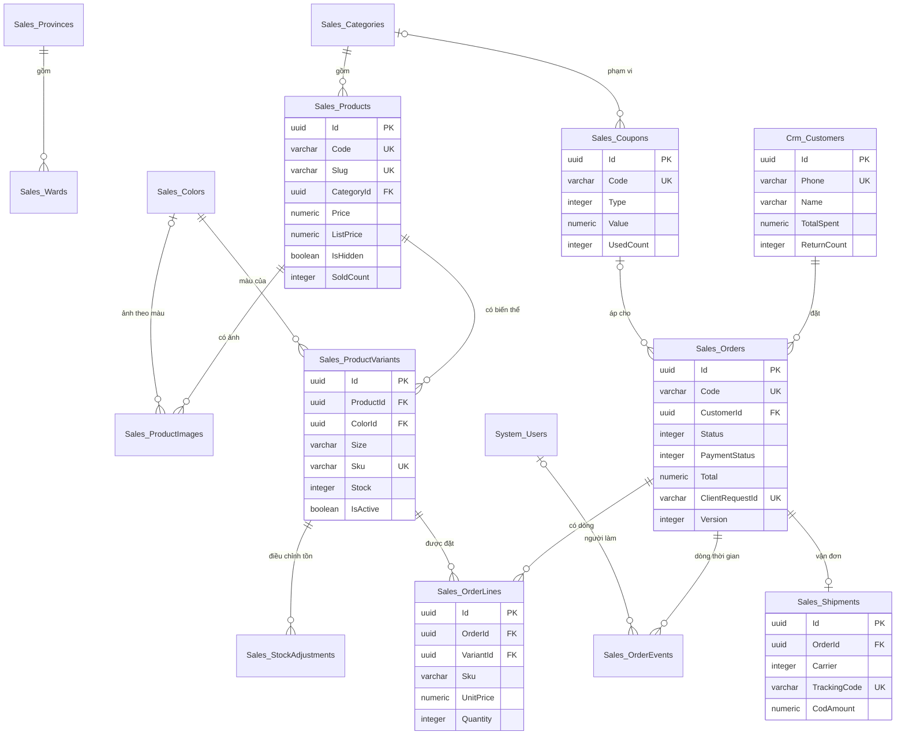

# Thiết kế CSDL — Website Bán hàng

> Database: `WebDemo_RetailWebsiteBanHang` (Postgres).
> Quy ước chung và nhóm bảng nền `System_*` (tài khoản, vai trò, quyền, cài đặt, nhật ký): xem `ZDOCS/03-KIEN-TRUC/THIET-KE-CSDL-NEN.md`.
> File này chỉ mô tả **bảng nghiệp vụ riêng của dự án**. Area: `Sales` (danh mục hành chính, sản phẩm, tồn kho, mã giảm giá, đơn hàng, vận đơn), `Crm` (khách hàng).
> Mã FR, BR, TC tham chiếu `02-SRS.md` và `05-KICH-BAN-KIEM-THU.md`. Hợp đồng API, công thức tiền, quy ước FE: `07-DANH-SACH-API.md`.

---

## 1. Sơ đồ

Thông tin cửa hàng (tên, hotline, địa chỉ kho, tài khoản nhận chuyển khoản) không có bảng riêng: lưu ở `System_Settings` nhóm "Cửa hàng" (§3). Banner trang chủ là nội dung tĩnh của bản demo (`banners` trong file seed), không có bảng.

---

## 2. Danh sách bảng

| Bảng | Area | Mô tả | Xóa | Dữ liệu mẫu |
| :--- | :--- | :--- | :--- | :---: |
| `Sales_Provinces` | Sales | Tỉnh/thành (34, sắp xếp 2025) kèm vùng phí vận chuyển | Không xóa | 34 |
| `Sales_Wards` | Sales | Phường/xã | Không xóa | 164 |
| `Sales_Categories` | Sales | Danh mục trên menu cửa hàng | Mềm, chặn khi còn sản phẩm | 8 |
| `Sales_Colors` | Sales | Danh mục màu dùng chung | Không có API xóa | 17 |
| `Sales_Products` | Sales | Sản phẩm | Mềm, chặn khi đã có trong đơn (BR-23) | 60 |
| `Sales_ProductImages` | Sales | Bộ ảnh sản phẩm, tối đa 8 | Cứng (thay cả bộ khi lưu sản phẩm) | 143 |
| `Sales_ProductVariants` | Sales | Biến thể màu × size, SKU, tồn | Cứng khi chưa có trong đơn; đã có thì chỉ tắt (BR-23) | 422 |
| `Sales_StockAdjustments` | Sales | Lịch sử điều chỉnh tồn thủ công | Không xóa | 8 |
| `Sales_Coupons` | Sales | Mã giảm giá | Mềm, chặn khi đã có lượt dùng (BR-26) | 5 |
| `Crm_Customers` | Crm | Hồ sơ khách theo số điện thoại | Không xóa | 300 |
| `Sales_Orders` | Sales | Đơn hàng | Không xóa | 796 |
| `Sales_OrderLines` | Sales | Dòng đơn, chụp tên, màu, size, SKU, ảnh, đơn giá (BR-25) | Không xóa (sửa đơn thì thay dòng) | 1.310 |
| `Sales_OrderEvents` | Sales | Dòng thời gian: đổi trạng thái, ghi chú nội bộ, tin gửi khách, sửa đơn, hoàn tiền | Không xóa | 6.237 |
| `Sales_Shipments` | Sales | Vận đơn (một đơn tối đa một) | Không xóa | 708 |

Số đơn, dòng, sự kiện, vận đơn là số seeder suy ra từ `FE/src/mock/seed/demo-data.json` (§5), đã gồm đơn chuyển khoản quá hạn tự hủy lúc nạp; chi tiết ở §5.7.

---

## 3. Quy ước chung của dự án

- Mọi bảng có cột chung `Id`, `CreatedAt`, `CreatedBy`, `UpdatedAt`, `UpdatedBy` theo `THIET-KE-CSDL-NEN.md` §1; bảng xóa mềm có thêm `IsDeleted`. Cột unique của bảng xóa mềm dùng index lọc bản ghi chưa xóa (`.IsUnique().WhereNotDeleted()`).
- Tiền `numeric(18,2)`, luôn là số nguyên đồng; giá bán, giá gốc là bội số 1.000 ₫ (BR-01). Số lượng, tồn kho `integer`. Giá đã gồm VAT, không có cột thuế.
- Thời gian lưu UTC. "Ngày" trong mã đơn, mã vận đơn, báo cáo, "hôm nay" tính theo giờ Việt Nam (`VietnamTime`, chép từ demo Quản lý Nhà hàng).
- Enum lưu `integer`, API trả chuỗi PascalCase không dấu (cùng tên enum C#, bảng tra ở `07` §2).
- Người thao tác được chụp vào bản ghi (`…Id` + `…Name` là họ tên) để dòng thời gian, phiếu giao không phụ thuộc tài khoản.
- **Khóa lạc quan**: `Sales_Orders.Version` là concurrency token (`IsConcurrencyToken()`), service tăng 1 ở mọi thay đổi của đơn (kể cả ghi chú nội bộ, in phiếu). Thao tác đổi đơn gửi kèm `version` (quy tắc ở `07` §3.6).
- **Chống trùng** (NFR-05): `Sales_Orders.ClientRequestId` unique, cho phép nhiều null. Gửi lại cùng mã trả đơn đã tạo (`07` §3.7).
- **Tồn không âm** (BR-13, NFR-05): trừ tồn bằng một câu cập nhật có điều kiện `Stock >= số lượng` cho từng dòng trong cùng transaction tạo đơn (`ExecuteUpdateAsync`, trung lập provider); một dòng không cập nhật được thì rollback cả đơn. Ràng buộc `CHECK (Stock >= 0)` khai báo bằng `ToTable(t => t.HasCheckConstraint(...))`.
- Mã chứng từ sinh trong service, trong transaction (SRS §5.3): đơn `DH` + `yyMMdd` (ngày đặt) + 4 số thứ tự trong ngày (BR-10); mã vận đơn = tiền tố đơn vị (`GHN`, `GHTK`, `VTP`, `JT`) + `yyMMdd` (ngày bàn giao) + 4 số thứ tự trong ngày của đơn vị đó, tổng 10 chữ số (BR-17). Trùng mã do hai request cùng lúc thì index unique báo lỗi, service thử lại một lần.
- Đơn, dòng đơn, sự kiện, vận đơn **không bao giờ xóa**, chỉ đổi trạng thái. Các bảng này và `Crm_Customers` (thống kê cập nhật theo đơn) đánh dấu `IAuditLogExempt`; sản phẩm, danh mục, mã giảm giá vẫn ghi nhật ký. Đặt lại dữ liệu demo xóa cứng toàn bộ bảng `Sales_*`, `Crm_*` (bảng con trước) rồi nạp lại.
- Cài đặt dùng chung lưu ở `System_Settings` (giá trị mẫu trong `FE/src/mock/seed/project.json`; nhãn tiếng Việt và quy tắc kiểm ở `FE/src/config/setting-labels.ts`):

| Khóa | Nhóm | Giá trị mẫu | Ghi chú |
| :--- | :--- | :--- | :--- |
| `Brand.AppName` | Thương hiệu | `Website Bán hàng` | Tên khu quản trị |
| `Brand.LogoUrl`, `Brand.PrimaryColor` | Thương hiệu | `/logo/logo-mark.svg`, `#1E40AF` | Logo, màu chính của cả website và quản trị (chữ trắng trên `#1E40AF` đạt 8,7:1) |
| `Store.Name`, `Store.Tagline` | Cửa hàng | `Nhà Sợi`, `Cotton, linen mặc mỗi ngày` | Đầu trang, tiêu đề trang, phiếu giao |
| `Store.Hotline`, `Store.Email` | Cửa hàng | `028 3000 1234`, `cskh@example.com` | Chân trang, phiếu giao (người gửi) |
| `Store.Address` | Cửa hàng | `48 Trần Quang Khải, Phường Tân Định, TP. Hồ Chí Minh` | Địa chỉ kho, người gửi trên phiếu giao |
| `Store.WorkingHours` | Cửa hàng | `8h–21h hằng ngày` | Câu "Shop sẽ gọi xác nhận trong giờ làm việc 8h–21h hằng ngày" (UC-04 bước 6) |
| `Store.BankBin`, `Store.BankAccount`, `Store.BankAccountName` | Cửa hàng | `970422`, `0000000000`, `NHA SOI` | QR chuyển khoản giả lập (BR-12) |

  Các con số cố định của SRS là hằng số trong code (`SalesRules`, BE và FE cùng giá trị, `07` §3): phí vận chuyển TP.HCM 20.000 ₫, tỉnh/thành khác 35.000 ₫, miễn phí từ 499.000 ₫ (BR-06); hạn thanh toán 24 giờ (BR-11); tồn sắp hết 1–5 (BR-02); mỗi dòng giỏ tối đa 10, giỏ tối đa 20 dòng, giỏ giữ 30 ngày (BR-03, BR-04); giao chậm sau 5 ngày (BR-18); khách VIP từ 5.000.000 ₫, cần lưu ý từ 2 đơn hoàn (BR-21); khối lượng 50–30.000 g (BR-17); tra cứu sai 5 lần trong 10 phút thì chặn 10 phút (BR-28).
- Ảnh mẫu: sản phẩm `/seed/products/{maSP}-{n}.webp` (vd `/seed/products/AT001-1.webp`, 1–3 ảnh mỗi sản phẩm), danh mục `/seed/categories/{maDanhMuc}.webp`, banner `/seed/banners/hero-{n}.webp`; FE phục vụ từ `FE/public/seed/`. Seed chỉ ghi tên file, seeder và FE mock ghép đường dẫn. Ảnh tải lên qua quản trị lưu `/uploads/products/{yyyy}/{MM}/{guid}.{ext}` theo `IFileStorage` nền. Sản phẩm, danh mục chưa có ảnh: FE hiện ô màu theo `Sales_Categories.Color` kèm chữ viết tắt.

---

## 4. Mô tả bảng

### `Sales_Provinces`: tỉnh/thành

| Cột | Kiểu | Ràng buộc | Ghi chú |
| :--- | :--- | :--- | :--- |
| `Code` | `varchar(10)` | unique | Mã 2 số, vd `79` |
| `Name` | `varchar(100)` | bắt buộc | `TP. Hồ Chí Minh` |
| `Zone` | `integer` | | Enum `ShippingZone` (BR-06) |
| `SortOrder` | `integer` | | Theo tên, TP.HCM và Hà Nội đứng đầu ở ô chọn (FE sắp) |

Enum `ShippingZone`: `0 TpHcm` TP.HCM (20.000 ₫), `1 TinhKhac` tỉnh/thành khác (35.000 ₫).

### `Sales_Wards`: phường/xã

| Cột | Kiểu | Ràng buộc | Ghi chú |
| :--- | :--- | :--- | :--- |
| `ProvinceId` | `uuid` | FK `Sales_Provinces`, có index | |
| `Code` | `varchar(10)` | unique | `{mã tỉnh}-{2 số}`, vd `79-03` |
| `Name` | `varchar(100)` | bắt buộc | `Phường Bến Thành` |

### `Sales_Categories`: danh mục

| Cột | Kiểu | Ràng buộc | Ghi chú |
| :--- | :--- | :--- | :--- |
| `Code` | `varchar(10)` | unique (chưa xóa) | 2 chữ in hoa, gợi ý tiền tố mã sản phẩm (`AT`) |
| `Name` | `varchar(100)` | bắt buộc | |
| `Slug` | `varchar(120)` | unique (chưa xóa) | BR-24 |
| `ImageUrl` | `varchar(500)` | null | Ảnh đại diện (FR-16) |
| `Color` | `varchar(7)` | bắt buộc | `#RRGGBB`, nền ô ảnh mặc định |
| `SortOrder` | `integer` | | Kéo thả; mới thêm = max + 10 |
| `IsVisible` | `boolean` | mặc định 1 | Ẩn: không hiện ở cửa hàng; link cũ về danh sách tất cả sản phẩm (UC-01 E2) |

### `Sales_Colors`: màu dùng chung

| Cột | Kiểu | Ràng buộc | Ghi chú |
| :--- | :--- | :--- | :--- |
| `Code` | `varchar(4)` | unique | 2 chữ in hoa dùng trong SKU (`TR`, `DE`, `XR`) |
| `Name` | `varchar(50)` | unique | `Xanh rêu` |
| `Hex` | `varchar(7)` | bắt buộc | Chấm màu ở nút chọn màu |
| `SortOrder` | `integer` | | |

### `Sales_Products`: sản phẩm

| Cột | Kiểu | Ràng buộc | Ghi chú |
| :--- | :--- | :--- | :--- |
| `Code` | `varchar(10)` | unique (chưa xóa) | 2 chữ in hoa + 3 số (BR-24) |
| `Name` | `varchar(200)` | bắt buộc | |
| `Slug` | `varchar(220)` | unique (chưa xóa) | BR-24; trùng thêm `-2`, `-3` |
| `NameSearch` | `varchar(1000)` | có index | Tên + mã + mọi SKU đã bỏ dấu, chữ thường, cập nhật khi lưu (tìm không dấu theo tên hoặc SKU, FR-06; Postgres dùng thêm `unaccent` qua `AppDbFunctions.Matches`) |
| `CategoryId` | `uuid` | FK `Sales_Categories`, có index | |
| `Price` | `numeric(18,2)` | > 0, bội số 1.000 | Giá bán, mọi biến thể dùng chung |
| `ListPrice` | `numeric(18,2)` | null; > `Price` | Giá gốc gạch ngang (BR-01) |
| `Description` | `text` | null | Chữ thường, xuống dòng bằng `\n` |
| `SizeChartJson` | `text` | null | `SizeChart` dạng JSON (`07` §2.4) |
| `IsFeatured` | `boolean` | | Nổi bật trên trang chủ (FR-04) |
| `IsHidden` | `boolean` | index `(IsHidden, CategoryId)` | Ẩn: trạng thái `An`; link cũ hiện "Sản phẩm ngừng kinh doanh" (BR-23) |
| `SoldCount` | `integer` | mặc định 0 | Σ số lượng dòng của đơn Đã giao; cộng khi đơn chuyển Đã giao; sắp xếp "Bán chạy" |
| `SortOrder` | `integer` | | Thứ tự trong quản trị |

Trạng thái `ProductStatus` suy ra: `IsHidden` → `An`, còn lại `DangBan`. Màu và size của sản phẩm suy ra từ biến thể theo `SortOrder` (lưới luôn đủ màu × size).

### `Sales_ProductImages`: ảnh sản phẩm

| Cột | Kiểu | Ràng buộc | Ghi chú |
| :--- | :--- | :--- | :--- |
| `ProductId` | `uuid` | FK, có index | |
| `Url` | `varchar(500)` | bắt buộc | |
| `ColorId` | `uuid` | null, FK `Sales_Colors` | Ảnh của màu đó (UC-02 bước 2) |
| `SortOrder` | `integer` | | Theo thứ tự gửi lên |
| `IsCover` | `boolean` | | Đúng một ảnh đại diện mỗi sản phẩm; không chọn thì ảnh đầu |

### `Sales_ProductVariants`: biến thể

| Cột | Kiểu | Ràng buộc | Ghi chú |
| :--- | :--- | :--- | :--- |
| `ProductId` | `uuid` | FK, unique `(ProductId, ColorId, Size)` | |
| `ColorId` | `uuid` | FK `Sales_Colors` | |
| `Size` | `varchar(10)` | null | Null khi sản phẩm không có size (túi, phụ kiện) |
| `Sku` | `varchar(30)` | unique | `{mã SP}-{mã màu}-{size}` hoặc `{mã SP}-{mã màu}` (BR-24) |
| `Stock` | `integer` | `CHECK (Stock >= 0)` | Tồn còn bán được, đã trừ đơn chưa hủy (SRS §1.3) |
| `IsActive` | `boolean` | mặc định 1 | Tắt: không bán, không hiện ở cửa hàng |
| `SortOrder` | `integer` | | `chỉ số màu × 100 + chỉ số size` |

Tình trạng (BR-02): `Stock = 0` → `HetHang`, 1–5 → `SapHet`, > 5 → `ConHang`. Biến thể `everOrdered` khi có ít nhất một `Sales_OrderLines.VariantId` trỏ tới (kiểm bằng `Any`).

### `Sales_StockAdjustments`: điều chỉnh tồn

| Cột | Kiểu | Ràng buộc | Ghi chú |
| :--- | :--- | :--- | :--- |
| `VariantId` | `uuid` | FK, có index | |
| `ProductId` | `uuid` | FK, có index | Lọc lịch sử theo sản phẩm |
| `Before`, `After` | `integer` | `After >= 0` | BR-27 |
| `Reason` | `integer` | | Enum `StockAdjustReason` |
| `Note` | `varchar(500)` | null | Bắt buộc khi `Khac` |
| `ById`, `ByName` | `uuid`, `varchar(150)` | | Người điều chỉnh |
| `At` | `timestamptz` | | |

Enum `StockAdjustReason`: `0 NhapHang` Nhập hàng, `1 KiemKe` Kiểm kê, `2 HangLoi` Hàng lỗi, `3 Khac` Khác.

### `Sales_Coupons`: mã giảm giá

| Cột | Kiểu | Ràng buộc | Ghi chú |
| :--- | :--- | :--- | :--- |
| `Code` | `varchar(20)` | unique (chưa xóa) | 4–20 chữ in hoa và số (BR-26); khách nhập không phân biệt hoa thường |
| `Name` | `varchar(200)` | bắt buộc | Mô tả hiện cho khách khi áp mã |
| `Type` | `integer` | | Enum `CouponType` |
| `Value` | `numeric(18,2)` | | % (1–50) hoặc số tiền (bội số 1.000); `MienPhiVanChuyen` = 0 |
| `MaxDiscount` | `numeric(18,2)` | null | Bắt buộc với `PhanTram` |
| `MinOrder` | `numeric(18,2)` | ≥ 0 | So với phần tạm tính thuộc phạm vi (BR-09) |
| `CategoryId` | `uuid` | null, FK | Null = toàn shop |
| `TotalLimit` | `integer` | null | Null = không giới hạn |
| `PerCustomerLimit` | `integer` | ≥ 1, mặc định 1 | Đếm theo số điện thoại |
| `UsedCount` | `integer` | | Số đơn chưa hủy có mã; cộng khi tạo đơn bằng câu cập nhật có điều kiện `TotalLimit IS NULL OR UsedCount < TotalLimit`, trừ khi đơn Đã hủy, không trừ khi hoàn hàng (BR-09) |
| `StartAt`, `EndAt` | `timestamptz` | `EndAt > StartAt` | |
| `IsPaused` | `boolean` | | Quản lý tạm dừng |

Enum `CouponType`: `0 PhanTram`, `1 SoTien`, `2 MienPhiVanChuyen`. Trạng thái `CouponStatus` suy ra lúc đọc theo thứ tự ưu tiên: `HetHan` (now > `EndAt`) → `TamDung` (`IsPaused`) → `SapChay` (now < `StartAt`) → `HetLuot` (`UsedCount >= TotalLimit`) → `DangChay`.

### `Crm_Customers`: khách hàng

| Cột | Kiểu | Ràng buộc | Ghi chú |
| :--- | :--- | :--- | :--- |
| `Phone` | `varchar(15)` | unique | Khóa nhận diện (FR-34), lưu dạng 10 số không dấu cách |
| `Name` | `varchar(100)` | bắt buộc | Lấy theo đơn mới nhất |
| `Email` | `varchar(200)` | null | Đơn mới có email thì cập nhật |
| `ProvinceCode`, `WardCode` | `varchar(10)` | | Địa chỉ đơn mới nhất |
| `AddressLine` | `varchar(200)` | | |
| `Note` | `varchar(1000)` | null | Ghi chú của quản lý (FR-36) |
| `OrderCount`, `DeliveredCount`, `ReturnCount`, `CancelledCount` | `integer` | | Mọi đơn; Đã giao; Đang hoàn + Đã hoàn; Đã hủy |
| `TotalSpent` | `numeric(18,2)` | có index | Σ `Total` đơn Đã giao (BR-21) |
| `FirstOrderAt`, `LastOrderAt` | `timestamptz` | `LastOrderAt` có index | |

Thống kê tính lại bằng một hàm `CustomerStats.Recalculate(customerId)` (đếm từ `Sales_Orders`) sau mọi thao tác đổi trạng thái hoặc tạo, sửa đơn của khách, trong cùng transaction. Nhãn suy ra lúc đọc: `KhachVip` khi `TotalSpent >= 5.000.000`, `CanLuuY` khi `ReturnCount >= 2`. Enum `CustomerTag`: `KhachVip`, `CanLuuY` (chỉ dùng trên API, không lưu).

### `Sales_Orders`: đơn hàng

| Cột | Kiểu | Ràng buộc | Ghi chú |
| :--- | :--- | :--- | :--- |
| `Code` | `varchar(20)` | unique | BR-10 |
| `CustomerId` | `uuid` | FK `Crm_Customers`, có index | |
| `PlacedAt` | `timestamptz` | bắt buộc, index `(Status, PlacedAt)` | |
| `Status` | `integer` | | Enum `OrderStatus` |
| `PaymentMethod` | `integer` | | Enum `PaymentMethod` |
| `PaymentStatus` | `integer` | | Enum `PaymentStatus` |
| `PaymentDueAt` | `timestamptz` | null, có index | Đơn chuyển khoản: `PlacedAt + 24 giờ` (BR-11) |
| `TransactionRef` | `varchar(30)` | null | Mã giao dịch ngân hàng 6–30 chữ, số (BR-12) |
| `PaidAt` | `timestamptz` | null | Chuyển khoản: lúc xác nhận tiền; COD: lúc Đã giao |
| `RefundAmount`, `RefundRef`, `RefundedAt` | `numeric(18,2)`, `varchar(30)`, `timestamptz` | null | BR-16 |
| `RecipientName` | `varchar(100)` | | BR-07 |
| `Phone` | `varchar(15)` | có index | Số điện thoại của đơn (tìm, BR-20) |
| `Email` | `varchar(200)` | null | |
| `ProvinceCode`, `ProvinceName`, `WardCode`, `WardName` | `varchar(10)`, `varchar(100)` | | Chụp tên để in phiếu, báo cáo theo tỉnh |
| `AddressLine` | `varchar(200)` | | 5–200 ký tự |
| `CustomerNote` | `varchar(500)` | null | Ghi chú của khách |
| `Subtotal`, `Discount`, `ShippingFee`, `ShippingDiscount`, `Total` | `numeric(18,2)` | | `07` §3.1–3.4; tính lại khi sửa đơn |
| `CouponId`, `CouponCode` | `uuid`, `varchar(20)` | null | Mã đã áp |
| `CancelReason` | `integer` | null | Enum `CancelReason` |
| `CancelNote` | `varchar(500)` | null | Bắt buộc khi `Khac` |
| `CancelledAt`, `CancelledById`, `CancelledByName` | | null | Người hủy: họ tên, "Khách" hoặc "Hệ thống" |
| `ClientRequestId` | `varchar(64)` | unique, cho phép nhiều null | NFR-05 |
| `DeviceId` | `varchar(64)` | null | Mã trình duyệt ẩn danh lúc đặt (`X-Device-Id`) |
| `Version` | `integer` | concurrency token | `07` §3.6 |

Enum `OrderStatus` (vòng đời SRS §5.2):

| Giá trị | Tên | Hiển thị | Ghi chú |
| :---: | :--- | :--- | :--- |
| 0 | `ChoThanhToan` | Chờ thanh toán | Chuyển khoản mới đặt |
| 1 | `ChoXacNhan` | Chờ xác nhận | COD mới đặt |
| 2 | `DaXacNhan` | Đã xác nhận | Chờ bàn giao vận chuyển |
| 3 | `DangGiao` | Đang giao | Có vận đơn |
| 4 | `DaGiao` | Đã giao | Tính doanh thu thuần theo ngày giao (BR-22) |
| 5 | `DangHoan` | Đang hoàn | Giao thất bại, hàng đang về kho |
| 6 | `DaHoan` | Đã hoàn | Đã nhận hàng hoàn, tồn đã cộng lại |
| 7 | `DaHuy` | Đã hủy | Tồn và lượt mã đã trả |

Enum `PaymentMethod`: `0 Cod`, `1 ChuyenKhoan`. Enum `PaymentStatus`: `0 ChuaThanhToan`, `1 DaThanhToan`, `2 CanHoanTien`, `3 DaHoanTien`. Enum `CancelReason`: `0 KhachDoiY` Khách đổi ý, `1 KhongLienLacDuoc` Không liên lạc được, `2 HetHang` Hết hàng, `3 DatTrung` Đặt trùng, `4 QuaHanThanhToan` Quá hạn thanh toán, `5 Khac` Khác.

Nhãn đơn (`OrderLabel`) không lưu, tính lúc đọc theo `07` §3.8: `TrungSdt`, `GiaoCham`, `KhachCanLuuY`.

### `Sales_OrderLines`: dòng đơn

| Cột | Kiểu | Ràng buộc | Ghi chú |
| :--- | :--- | :--- | :--- |
| `OrderId` | `uuid` | FK, có index | |
| `VariantId`, `ProductId` | `uuid` | FK, có index | `ProductId` để báo cáo theo sản phẩm |
| `ProductName` | `varchar(200)` | | Chụp lúc đặt (BR-25) |
| `Sku` | `varchar(30)` | | |
| `ColorName` | `varchar(50)` | | |
| `Size` | `varchar(10)` | null | |
| `ImageUrl` | `varchar(500)` | null | Ảnh của màu đó, không có thì ảnh đại diện |
| `UnitPrice` | `numeric(18,2)` | | Giá bán lúc đặt |
| `Quantity` | `integer` | 1–10 | BR-03 |
| `SortOrder` | `integer` | | Thứ tự trong giỏ |

Thành tiền dòng = `UnitPrice × Quantity` (không lưu).

### `Sales_OrderEvents`: dòng thời gian

| Cột | Kiểu | Ràng buộc | Ghi chú |
| :--- | :--- | :--- | :--- |
| `OrderId` | `uuid` | FK, index `(OrderId, At)` | |
| `Type` | `integer` | | Enum `OrderEventType` |
| `At` | `timestamptz` | | |
| `ActorType` | `integer` | | Enum `ActorType` |
| `ActorId` | `uuid` | null | Tài khoản khi `NhanVien` |
| `ActorName` | `varchar(150)` | | Họ tên, "Khách" hoặc "Hệ thống" |
| `FromStatus`, `ToStatus` | `integer` | null | Chỉ `DoiTrangThai`; tạo đơn có `FromStatus` null |
| `Content` | `varchar(1000)` | | Câu theo `07` §3.10 |
| `Seq` | `integer` | | Thứ tự trong cùng thời điểm (đổi trạng thái trước, tin gửi khách sau) |

Enum `OrderEventType`: `0 DoiTrangThai`, `1 GhiChuNoiBo`, `2 TinGuiKhach`, `3 SuaDon`, `4 HoanTien`. Enum `ActorType`: `0 NhanVien`, `1 Khach`, `2 HeThong`.

### `Sales_Shipments`: vận đơn

| Cột | Kiểu | Ràng buộc | Ghi chú |
| :--- | :--- | :--- | :--- |
| `OrderId` | `uuid` | FK, unique | Một đơn một vận đơn |
| `Carrier` | `integer` | | Enum `Carrier` |
| `TrackingCode` | `varchar(20)` | unique | BR-17, §3 |
| `WeightGrams` | `integer` | 50–30.000 | |
| `CodAmount` | `numeric(18,2)` | | `Total` với COD, 0 với chuyển khoản (BR-17) |
| `ShipperNote` | `varchar(200)` | null | "Cho xem hàng, không cho thử" |
| `HandedOverAt`, `HandedOverById`, `HandedOverByName` | | | Lúc bàn giao, có index `HandedOverAt` (BR-18) |
| `DeliveredAt` | `timestamptz` | null, có index | Ngày tính doanh thu thuần |
| `FailedAt`, `FailReason`, `FailNote` | | null | Enum `DeliveryFailReason`; `FailNote` bắt buộc khi `Khac` |
| `ReturnedAt` | `timestamptz` | null | Đã nhận hàng hoàn |
| `LabelPrintCount` | `integer` | mặc định 0 | > 0 thì bản in có dòng "IN LẠI" (UC-10 5a) |

Enum `Carrier`: `0 Ghn` GHN, `1 Ghtk` GHTK, `2 Vtp` Viettel Post, `3 Jt` J&T Express. Enum `DeliveryFailReason`: `0 KhachKhongNgheMay`, `1 KhachTuChoiNhan`, `2 SaiDiaChi`, `3 Khac`.

---

## 5. Dữ liệu mẫu

Nguồn duy nhất: `FE/src/mock/seed/demo-data.json` (FE mock nạp trực tiếp; BE nhúng làm EmbeddedResource, đọc bằng `SeedJson`). Phần `colors`, `sizeCharts`, `categories`, `products`, `coupons`, `banners`, `provinces`, `stockAdjustments` viết tay; `customers`, `orders` do `FE/scripts/generate-orders.mjs` sinh (`pnpm seed:orders`, hạt giống `20261015`, chạy lại ra đúng file cũ; script ghi đè hai mảng này, giữ nguyên phần viết tay, tự kiểm các ràng buộc ở §5.6 trước khi ghi, kiểm JSON hợp lệ sau khi ghi). File khoảng 251 KB.

Cửa hàng mẫu: **Nhà Sợi**, shop thời trang basic (cotton, linen) bán online toàn quốc, một kho ở TP.HCM. Nhân viên mẫu: `nhanvien` (Lê Hoàng Nam, ca ngày, bàn giao vận chuyển), `nhanvien2` (Phạm Thu Trang, ca tối 17h–21h30); `quanly` (Trần Thị Mai) thỉnh thoảng xác nhận đơn, là người hoàn tiền và điều chỉnh tồn.

### 5.1. Số lượng

| Dữ liệu | Số lượng | Đặc điểm |
| :--- | :---: | :--- |
| Danh mục | 8 | Áo thun `AT` (10 sản phẩm), Áo sơ mi `SM` (9), Áo khoác `AK` (6), Quần jeans `QJ` (8), Quần kaki, short `QK` (7), Váy đầm `VD` (9), Túi xách `TX` (6), Phụ kiện `PK` (5) |
| Màu | 17 | Có `TR` Trắng, `DE` Đen, `BE` Be, `KE` Kem, `XN` Xanh nhạt, `XR` Xanh rêu (TC-21) |
| Sản phẩm | 60 | `AT001`–`PK005`; 14 đang giảm giá, 8 nổi bật, 1 ẩn (`AK006` Áo blazer dáng suông); `PK004` Khăn lụa vuông hết hàng mọi biến thể; chưa có `SM010`, chưa có slug `ao-so-mi-linen` (TC-21) |
| Biến thể | 422 | 2 biến thể tắt (`VD008-DO-S`, `QJ005-XA-32`); 21 biến thể sắp hết (1–5), 9 hết hàng (sản phẩm đang bán) |
| Ảnh sản phẩm | 143 | 1–3 ảnh mỗi sản phẩm, ảnh n gắn màu thứ n |
| Mã giảm giá | 5 | `GIAM10`, `GIAM50K`, `FREESHIP`, `AOTHUN15` (danh mục Áo thun) đang chạy; `HETHAN` đã hết hạn; chưa có `SALE1111` (TC-41) |
| Tỉnh/thành, phường/xã | 34, 164 | 34 tỉnh/thành theo sắp xếp 2025; phường/xã **rút gọn** 2–27 mỗi tỉnh (§5.5) |
| Điều chỉnh tồn | 8 | Trong 62 ngày, gồm `AT001-BE-XL` 4 → 0 "Hàng lỗi" |
| Khách hàng | 300 | 6 khách VIP, 10 khách cần lưu ý (gồm Lê Thị Hoa); 101 khách có email |
| Đơn hàng | 796 | 775 đơn 89 ngày trước + 21 đơn hôm nay; đủ 8 trạng thái (§5.7) |

### 5.2. Cấu trúc file và cách seeder suy ra trường

| Phần | Trường trong file | Seeder và FE mock suy ra |
| :--- | :--- | :--- |
| `colors[]` | `code`, `name`, `hex`, `sortOrder` | |
| `sizeCharts` | Khóa → `{ title, columns, rows }` | Chép vào `SizeChartJson` của sản phẩm tham chiếu |
| `categories[]` | `code`, `name`, `slug`, `color`, `image`, `sortOrder` | `ImageUrl = "/seed/categories/" + image`; `IsVisible = true` |
| `products[]` | `code`, `name`, `category` (mã danh mục), `price`, `listPrice?`, `colors` (mã màu theo thứ tự), `sizes` (`[]` = không size), `sizeChart?` (khóa), `stock` (`"{màu}-{size}"` hoặc `"{màu}"` → tồn), `off?` (biến thể tắt), `images` (`[tên file, mã màu]`), `featured?`, `hidden?`, `createdDaysAgo`, `sortOrder`, `description` | `Slug` theo BR-24 từ `name`; `CreatedAt` = 00:00 giờ Việt Nam của ngày (hôm nay − `createdDaysAgo`) + `sortOrder` giây (để "Mới nhất" có thứ tự ổn định); biến thể sinh đủ lưới `colors × sizes`, `Sku` theo BR-24, `SortOrder` = chỉ số màu × 100 + chỉ số size; ảnh `Url = "/seed/products/" + tên`, `SortOrder` theo thứ tự, ảnh đầu là ảnh đại diện; `SoldCount` = Σ số lượng dòng của đơn Đã giao sau khi nạp |
| `coupons[]` | `code`, `name`, `type`, `value`, `maxDiscount?`, `minOrder`, `scope?` (mã danh mục), `totalLimit?`, `perCustomer?` (mặc định 1), `start`, `end` (`"dayOffset:N@HH:mm"` giờ Việt Nam) | `IsPaused = false`; `UsedCount` = số đơn chưa hủy có mã sau khi nạp |
| `banners[]` | `image`, `title`, `subtitle`, `link`, `buttonText` | Chỉ FE dùng (`/seed/banners/` + image); BE bỏ qua |
| `provinces[]` | `code`, `name`, `zone?` (vắng = `TinhKhac`), `wards` (`[mã, tên]`) | `SortOrder` theo thứ tự trong file |
| `stockAdjustments[]` | `[SKU, "daysAgo:N@HH:mm", trước, sau, lý do, tên đăng nhập, ghi chú]` | Người điều chỉnh tra từ `System_Users` |
| `customers[]` | `phone`, `name`, `email?`, `province`, `ward`, `address`, `note?` | Thống kê, `FirstOrderAt`, `LastOrderAt`, `CreatedAt` tính từ đơn (§3, bảng `Crm_Customers`) |
| `orders[]` | Khóa gọn §5.4 | §5.4 |

Tồn trong `products[].stock` là **tồn lúc nạp** (đã trừ đơn chưa hủy); seeder không trừ lại theo đơn lịch sử. Ngoại lệ duy nhất: đơn chuyển khoản quá hạn bị hệ thống tự hủy lúc nạp thì tồn của nó được cộng lại như mọi lần hủy (đơn này không chứa biến thể dùng trong test).

Id ở FE mock cố định qua mỗi lần nạp: `stableId('category', code)`, `stableId('color', code)`, `stableId('product', code)`, `stableId('variant', sku)`, `stableId('image', tên file)`, `stableId('coupon', code)`, `stableId('customer', phone)`, `stableId('order', chỉ số trong file)`, `stableId('order-line', chỉ số đơn, chỉ số dòng)`, `stableId('order-event', chỉ số đơn, thứ tự sự kiện)`, `stableId('province', code)`, `stableId('stock-adjustment', chỉ số)`. BE sinh `Guid` mới. Mọi tài khoản trong file (`by`) là tên đăng nhập, seeder tra ra `Id` và họ tên trong `System_Users`.

### 5.3. Thời điểm tương đối

- `now` = thời điểm nạp seed, **làm tròn xuống tới phút**. Đơn không có `d` là đơn gần đây: `t` là số phút (âm) so với `now`. Thời điểm sự kiện dạng `"n-N"` là `now − N phút` (dùng cho đơn ngày trước được giao xong, giao thất bại trong hôm nay).
- Đơn có `d` (−89…−1): ngày = hôm nay (giờ Việt Nam) + `d`, giờ `t` dạng `HH:mm` giờ Việt Nam, đổi sang UTC. Không ánh xạ thứ trong tuần.
- Thời điểm sự kiện dạng số là số phút sau `PlacedAt`. Script bảo đảm mọi sự kiện dạng số của đơn có `d` rơi trước 00:00 hôm nay, và sự kiện `"n-N"` đến sau sự kiện trước đó với mọi giờ nạp từ 05:00.
- Mọi đơn hôm nay đặt trong 470 phút trước `now`, trừ đơn quá hạn (−1500 phút). Nạp sau 08:00 thì cả 20 đơn này cùng thuộc "hôm nay" và số ở §5.6 đúng; nạp sớm hơn thì một phần rơi sang hôm qua.
- FE mock lưu `now` lúc nạp và tự nạp lại khi sang ngày mới theo giờ Việt Nam (`07` §4.8); BE nạp khi đặt lại dữ liệu (`DemoResetJob` chạy mỗi ngày theo `DEMO_RESET_CRON`).

### 5.4. Khóa gọn của đơn

Mỗi đơn một dòng JSON, đơn sắp theo thời điểm đặt.

| Khóa | Ý nghĩa | Ví dụ |
| :--- | :--- | :--- |
| `d` | Ngày so với hôm nay; vắng = đơn gần đây | `-12` |
| `t` | Giờ đặt `HH:mm` (khi có `d`) hoặc số phút so với `now` | `"20:41"`, `-120` |
| `c` | Số điện thoại khách (`customers[].phone`) | `"0987654321"` |
| `pm` | `"C"` COD, `"B"` chuyển khoản | `"C"` |
| `it` | Dòng `[SKU, số lượng]` | `[["AT001-TR-M", 2]]` |
| `cp` | Mã giảm giá | `"GIAM10"` |
| `n` | Ghi chú của khách | `"Giao sau 17h"` |
| `ev` | Sự kiện sau khi đặt, theo thứ tự thời gian: `[loại, thời điểm, người, …]` | |

| Loại `ev` | Dạng | Chuyển trạng thái |
| :--- | :--- | :--- |
| `cf` | `["cf", t, by]` | `ChoXacNhan` → `DaXacNhan` |
| `pd` | `["pd", t, by, mã giao dịch]` | `ChoThanhToan` → `DaXacNhan`, `PaymentStatus = DaThanhToan`, `PaidAt = t` |
| `sh` | `["sh", t, by, "GHN"\|"GHTK"\|"VTP"\|"JT", khối lượng g]` | `DaXacNhan` → `DangGiao`, tạo vận đơn |
| `dv` | `["dv", t, by]` | `DangGiao` → `DaGiao`; COD `DaThanhToan`, `PaidAt = t`; `DeliveredAt = t` |
| `fl` | `["fl", t, by, lý do, ghi chú?]` | `DangGiao` → `DangHoan` |
| `rt` | `["rt", t, by]` | `DangHoan` → `DaHoan`, `ReturnedAt = t` |
| `cx` | `["cx", t, by \| "K" \| "S", lý do, ghi chú?]` | → `DaHuy`; `"K"` = Khách, `"S"` = Hệ thống; đã thanh toán thì `CanHoanTien`, `RefundAmount = Total` |
| `rf` | `["rf", t, by, mã giao dịch hoàn]` | `CanHoanTien` → `DaHoanTien` |
| `nt` | `["nt", t, by, nội dung]` | Ghi chú nội bộ, không đổi trạng thái |

Quy tắc suy ra (seeder và FE mock phát lại sự kiện qua **cùng hàm chuyển trạng thái** với API, chỉ khác là không trừ tồn, không gửi tin):

1. **Đơn**: trạng thái đầu `ChoXacNhan` (COD) hoặc `ChoThanhToan` (`PaymentDueAt = PlacedAt + 24 giờ`). Người nhận, số điện thoại, email, địa chỉ chụp từ `customers[]`; tên tỉnh, phường tra từ `provinces`. Dòng chụp tên, màu, size, SKU, ảnh (ảnh của màu, không có thì ảnh đại diện), `UnitPrice` = giá bán hiện tại của sản phẩm. Tiền tính theo `07` §3 với mã `cp`. `Code` = `DH` + `yyMMdd` (ngày đặt giờ Việt Nam) + số thứ tự theo `(PlacedAt, chỉ số trong file)` trong ngày. `ClientRequestId`, `DeviceId` null; `Version` = số sự kiện + 1.
2. **Sự kiện**: theo bảng trên, chữ theo `07` §3.10. Tạo đơn sinh `DoiTrangThai` (người "Khách") và `TinGuiKhach` (SMS; thêm một tin email khi khách có email).
3. **Vận đơn**: `TrackingCode` theo §3 với số thứ tự theo `(HandedOverAt, mã đơn)` của từng đơn vị trong ngày; `CodAmount` theo BR-17; `LabelPrintCount = 1`.
4. **Khách, mã, sản phẩm**: sau khi nạp mọi đơn, tính thống kê khách, `UsedCount` của mã, `SoldCount` của sản phẩm.
5. **Đơn quá hạn**: ngay sau khi nạp, chạy quét quá hạn thanh toán (`07` §3.5) như lúc vận hành: đơn chuyển khoản đặt 25 giờ trước thành `DaHuy` lý do `QuaHanThanhToan`, người làm "Hệ thống", `CancelledAt = PaymentDueAt`, tồn cộng lại.

### 5.5. Danh mục hành chính rút gọn

34 tỉnh/thành đúng tên theo sắp xếp đơn vị hành chính 2025, mã 2 số theo danh mục mới. Phường/xã chỉ lấy một phần (TP.HCM 27, Hà Nội 19, Đà Nẵng 12, Cần Thơ 8, Hải Phòng 6, Huế 5, còn lại 2–4 mỗi tỉnh), tên ghi tiền tố "Phường", mã nội bộ `{mã tỉnh}-{2 số}` không phải mã thống kê chính thức. Đủ cho demo và test (Phường Bến Thành, Phường Cầu Giấy). Bản triển khai nạp đủ khoảng 3.300 phường/xã từ danh mục chính thức vào cùng bảng.

### 5.6. Trạng thái lúc nạp và ràng buộc test (05-KICH-BAN-KIEM-THU §1)

| Dữ liệu | Giá trị | Dùng ở |
| :--- | :--- | :--- |
| `AT001` Áo thun cotton basic | 159.000 ₫, giá gốc 199.000 ₫ (−20%); Trắng, Đen, Be × S, M, L, XL; tồn Trắng/M **50**, Đen/L **3**, Be/XL **0** | TC-01…10, TC-17, demo bước 1–3 |
| `QJ003` Quần jeans ống suông | 389.000 ₫; Xanh nhạt × 26–30; tồn size 28 **8** | TC-05, TC-09, TC-11, TC-12, TC-16 |
| `TX001` Túi tote canvas | 129.000 ₫; Kem, không size, một biến thể; tồn **20** | TC-11, TC-20, TC-32 |
| `VD002` Đầm midi hoa nhí | 389.000 ₫ (gốc 459.000 ₫), đã bán 44 cái trong đơn Đã giao, nên không xóa được | TC-23 |
| Mã giảm giá | `GIAM10` 10%, tối đa 50.000 ₫, đơn từ 300.000 ₫, 1 lượt mỗi số; `GIAM50K` 50.000 ₫, đơn từ 500.000 ₫; `FREESHIP` đơn từ 200.000 ₫, 3 lượt mỗi số; `AOTHUN15` 15% phần áo thun, tối đa 30.000 ₫, từ 250.000 ₫; `HETHAN` hết hạn 40 ngày trước | TC-09…14, TC-41 |
| Lê Thị Hoa `0987654321` | Đồng Nai, đúng 2 đơn Đã hoàn (50 và 21 ngày trước) + 1 đơn COD Chờ xác nhận đặt 50 phút trước; ghi chú khách có sẵn | TC-25, TC-42, demo bước 6 |
| Đơn chuyển khoản | Một đơn đặt 1.500 phút trước (tự hủy lúc nạp, không chứa biến thể test); một đơn đặt 120 phút trước và một đơn 35 phút trước còn Chờ thanh toán | TC-34, demo bước 7 |
| Cặp Trùng SĐT | Hai đơn COD của `0582966421` đặt 260 và 230 phút trước, đều Chờ xác nhận; không có cặp nào khác | FR-21 |
| Số dành cho test | `0901000001`…`0901000019`, `0901000088` không có trong dữ liệu | TC-08…42 |

Script kiểm và dừng nếu sai: đúng 8 danh mục, 60 sản phẩm, các giá trị ở bảng trên; đủ 8 trạng thái đơn; mỗi khách ít nhất 1 đơn; SKU tồn tại, biến thể đang bật, không bán sản phẩm trước ngày tạo, không bán `AK006` trong 20 ngày gần nhất; mã giảm giá trong thời gian hiệu lực, đạt đơn tối thiểu, không vượt lượt mỗi số, tổng lượt; sự kiện đúng thứ tự thời gian; chỉ một cặp Trùng SĐT; đơn của Lê Thị Hoa đúng như trên.

Số tính sẵn của test (công thức ở `07` §3.11): TC-08 **338.000**; TC-09 **657.000**; TC-10 **322.000**; TC-11 **503.000**; TC-12 **389.000**; TC-16 **409.000**; TC-29 **636.000**; TC-32 **149.000**.

### 5.7. Kết quả chạy script lần gần nhất

| Chỉ số | Giá trị |
| :--- | :--- |
| Đơn | **796** = 775 lịch sử 89 ngày + 21 đơn gần đây (gồm đơn quá hạn); 1.310 dòng; COD 566, chuyển khoản 230 |
| Trạng thái sau khi nạp | Chờ thanh toán 2, Chờ xác nhận 17, Đã xác nhận 7, Đang giao 18 (2 giao chậm), Đã giao 614, Đang hoàn 2, Đã hoàn 74, Đã hủy 62 |
| Tỉ lệ | Hủy 7,8% (62/796); hoàn 11,0% (76/690); đơn lịch sử đặt 20h–22h59 chiếm 42,8% |
| Lý do hủy | Khách đổi ý 21, Quá hạn thanh toán 20 (gồm đơn tự hủy lúc nạp), Không liên lạc được 9, Đặt trùng 7, Hết hàng 3, Khác 2; người hủy: Khách 18, Hệ thống 20, nhân viên 24 |
| Lý do giao thất bại | Khách không nghe máy 34, Khách từ chối nhận 21, Sai địa chỉ 14, Khác 7 |
| Vận đơn | 708: GHTK 246, GHN 196, Viettel Post 152, J&T Express 114 |
| Lượt dùng mã (đơn chưa hủy) | `GIAM10` 51, `GIAM50K` 14, `FREESHIP` 23, `AOTHUN15` 1, `HETHAN` 24 |
| Doanh thu thuần các ngày trước hôm nay | **332.576.000 ₫** trên 602 đơn giao xong |
| Hôm nay (nạp sau 08:00) | 20 đơn đặt, giá trị đặt hàng (không tính đơn hủy) **11.134.000 ₫**; 12 đơn giao xong hôm nay, doanh thu thuần **5.592.000 ₫** |
| Bán chạy (Đã giao, mọi thời gian) | `AT001` 90, `SM001` 56, `AK001` 50, `VD001` 45, `VD002` 44 |
| Ba đơn đầu ô −89 | 07:33 `0932392694` **718.000 ₫**; 15:51 `0776861929` **378.000 ₫**; 19:58 `0857979121` **354.000 ₫** |
| Kích thước `demo-data.json` | ~251 KB |

BE và FE đối chiếu các tổng trên (nhất là doanh thu thuần qua `GET /api/reports/revenue` 89 ngày trước hôm nay, số đơn theo trạng thái qua `GET /api/orders/status-counts`, tỉ lệ hủy và hoàn) để xác nhận cách nạp seed và công thức giống nhau.
